## 文档

菜鸟

[https://www.runoob.com/django/django-project-intro.html](https://www.runoob.com/django/django-project-intro.html)

官方

[https://docs.djangoproject.com/zh-hans/5.2/intro/tutorial01](https://docs.djangoproject.com/zh-hans/5.2/intro/tutorial01)

项目

[https://soberlydream.com/markdown/142/Django%E5%BF%AB%E9%80%9F%E5%85%A5%E9%97%A8/markdownData/13.%E5%AE%9E%E6%88%98%E6%A1%88%E4%BE%8B#titleId-87](https://soberlydream.com/markdown/142/Django%E5%BF%AB%E9%80%9F%E5%85%A5%E9%97%A8/markdownData/13.%E5%AE%9E%E6%88%98%E6%A1%88%E4%BE%8B#titleId-87)

## 安装

```
 python -m pip install Django 
```

## 创建项目

如果这是你第一次使用 Django，你需要做一些初始设置。也就是说，你需要自动生成一些代码来建立一个 Django项目-一个 Django 实例的设置集合，包括数据库配置，Django 特定的选项和应用程序特定的设置。

在命令行中，`cd` 到一个你想存储代码的目录，并创建一个名为 `djangotutorial 的`新目录。(This 目录名对 Django 来说并不重要;您可以将其重命名为任何您喜欢的名称。

```
mkdir djangotutorial
```

然后，运行以下命令来引导一个新的 Django 项目：

```
django-admin startproject mysite djangotutorial
```

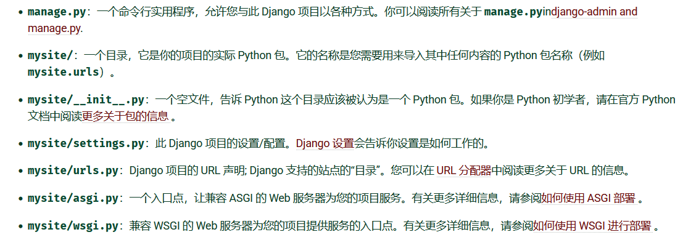

## 开发服务器

让我们验证一下你的 Django 项目是否有效。进入 `djangotutorial` 目录，如果您还没有，并运行以下命令：

```
python manage.py runserver
```

## 创建 Polls 应用程序

现在您的环境-一个“项目”-已经设置好了，您可以开始工作了。

你在 Django 中编写的每个应用程序都包含一个遵循特定约定的 Python 包。Django 附带了一个实用程序，可以自动生成应用程序的基本目录结构，因此您可以专注于编写代码而不是创建目录。

```
python manage.py startapp polls
```

在mysite中的Setting.py文件配置应用程序

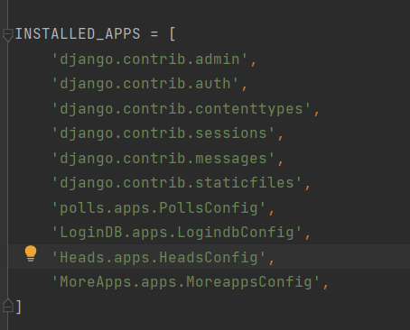

## 编写第一个视图

让我们写第一个视图。打开文件 `polls/views.py` 并将以下 Python 代码放入其中：

```
from django.http import HttpResponse

def index(request):
    return HttpResponse("Hello, world. You're at the polls index.")
```

这是 Django 中最基本的视图。要在浏览器中访问它，我们需要将它映射到一个 URL -为此，我们需要定义一个 URL 配置，或简称为“URLconf”。这些 URL 配置在每个 Django 应用程序内部定义，它们是名为 `urls.py`Python 文件。

要定义`民意调查`应用程序的 URLconf，请创建文件 `polls/urls.py` 内容如下：

```
from django.urls import path

from . import views

urlpatterns = [
    path("", views.index, name="index"),
]
```

下一步是在 `mysite` 项目中配置根 URLconf，以包含 `polls.urls` 中定义的 URLconf。为此，请为 `django.urls.include`in`mysite/urls.py` and insert an 在 `urlpatterns` 列表中包含（），所以你有：

```
from django.contrib import admin
from django.urls import include, path

urlpatterns = [
    path("polls/", include("polls.urls")),
    path("admin/", admin.site.urls),
]
```

path()函数至少需要两个参数： `路线`和`观点` 。include()函数允许引用其他 URLconf。每当 Django 遇到 include()时，它会删除到该点为止匹配的 URL 的任何部分，并将剩余的字符串发送到包含的 URLconf 进行进一步处理。

include()背后的想法是使即插即用的 URL 变得容易。由于投票是在自己的 URLconf（`polls/urls.py`），他们可以放置在“/polls/"下，或在“/fun\_polls/"下，或在“/content/polls/"下，或任何其他路径根，应用程序仍然可以工作。

现在您已经将`索引`视图连接到 URLconf 中。使用以下命令验证它是否正常工作

```
python manage.py runserver
```

## 连接数据库

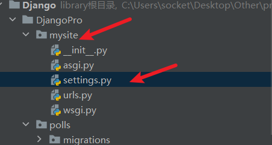

找到databases

```
DATABASES = {
    'default': {
        'ENGINE': 'django.db.backends.mysql',  # 数据库引擎（MySQL）
        'NAME': 'socket',  # 要连接的数据库名称（必须先在MySQL中创建）
        'USER': 'root',  # 这里是错误中的用户名，可能需要修改
        'PASSWORD': 'f71796316',  # 密码（错误提示"using password: NO"说明这里为空）
        'HOST': 'localhost',  # 数据库主机（本地通常是localhost）
        'PORT': '3306',  # 端口（默认3306）
    }
}
```

编辑 `polls/models.py` 文件

```
from django.db import models

class Question(models.Model):
    question_text = models.CharField(max_length=200)
    pub_date = models.DateTimeField("date published")

class Choice(models.Model):
    question = models.ForeignKey(Question, on_delete=models.CASCADE)
    choice_text = models.CharField(max_length=200)
    votes = models.IntegerField(default=0)
```

```
# 依次执行以下两条指令
python manage.py migrate
python manage.py makemigrations
python manage.py migrate
```

## 模型

在models.py中设置数据库

```
from django.db import models

# Create your models here.
class Student(models.Model):
    student_id = models.CharField(
        verbose_name='学号',#别名
        max_length=20,#最大长度
        unique=True,#唯一
    )

    name = models.CharField(
        verbose_name='姓名',
        max_length=50
    )

    email = models.EmailField(
        verbose_name='邮箱',
        unique=True,
    )

    password = models.CharField(
        verbose_name='密码',
        max_length=16
    )

    created_at = models.DateTimeField(
        verbose_name='创建时间',
        auto_now_add=True
    )

    updated_at = models.DateTimeField(
        verbose_name='更新时间',
        auto_now=True
    )

    class Meta:
        db_table = 'tb_student'
        verbose_name = '学生信息'
        verbose_name_plural = '学生信息'
```

选择是否到admin中管理

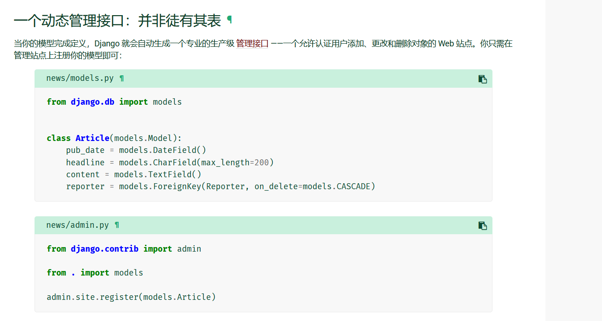

## 设置语言时区

1）本地化 (语言和时区)

修改settings.py文件。

```
# LANGUAGE_CODE = 'en-us'
LANGUAGE_CODE = 'zh-hans'    # 指定语言（注意不要写错，否则无法启动服务器）
 
# TIME_ZONE = 'UTC'
TIME_ZONE = 'Asia/Shanghai'  # 指定时间
```

## `app` 管理

把根目录下所有 `App` 统一移动到新建的 `app/` 目录，保证 运行不报错、导入不飘红、`PyCharm` 跳转正常。

注意：`APP` 的移动会导致创建其他 `app` 和运行错误时，同学们可以使用以下方式进行解决。

> 报错提示 `ModuleNotFoundError: No module named '***'`，提示说找不到模块。

```
# 根目录下/manage.py

import os
import sys
# 引入模块
from pathlib import Path

def main():
    """Run administrative tasks."""
    os.environ.setdefault('DJANGO_SETTINGS_MODULE', 'djangoProject.settings')
    # 添加此处的代码即可解决
    sys.path.append(os.path.join(Path(__file__).resolve().parent, 'app'))
    try:
        from django.core.management import execute_from_command_line
    except ImportError as exc:
        raise ImportError(
            "Couldn't import Django. Are you sure it's installed and "
            "available on your PYTHONPATH environment variable? Did you "
            "forget to activate a virtual environment?"
        ) from exc
    execute_from_command_line(sys.argv)

if __name__ == '__main__':
    main()
```

## 创建admin用户

首先，我们需要创建一个可以登录到管理站点的用户。运行以下命令：

```
 python manage.py createsuperuser
```

输入你想要的用户名，然后按回车键。

```
Username: adminEmail address: admin@example.com最后一步是输入您的密码。您将被要求输入密码两次，第二次作为第一次的确认。Password: **********Password (again): *********Superuser created successfully.
```

启动开发服务器

Django 管理站点默认是激活的。让我们启动开发服务器并研究它。

如果服务器没有运行，则按如下方式启动

```
python manage.py runserver
```

向管理页面中加入投票应用

但是我们的投票应用在哪呢？它没在索引页面里显示。

只需要再做一件事：我们得告诉管理，问题 `Question` 对象需要一个后台接口。打开 `polls/admin.py` 文件，把它编辑成下面这样

```
from django.contrib import admin

from .models import Question

admin.site.register(Question)
```

## 目录结构

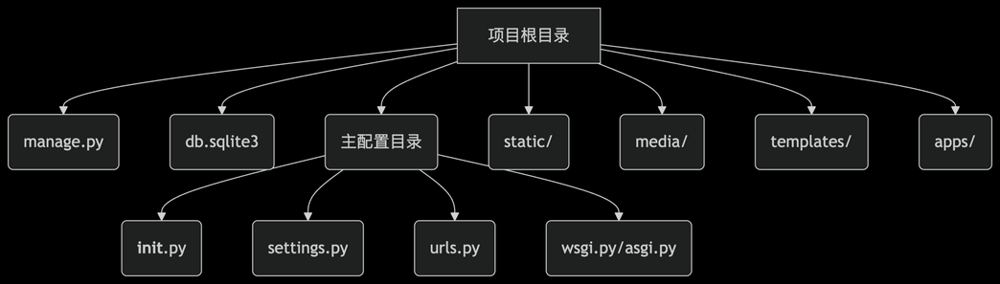

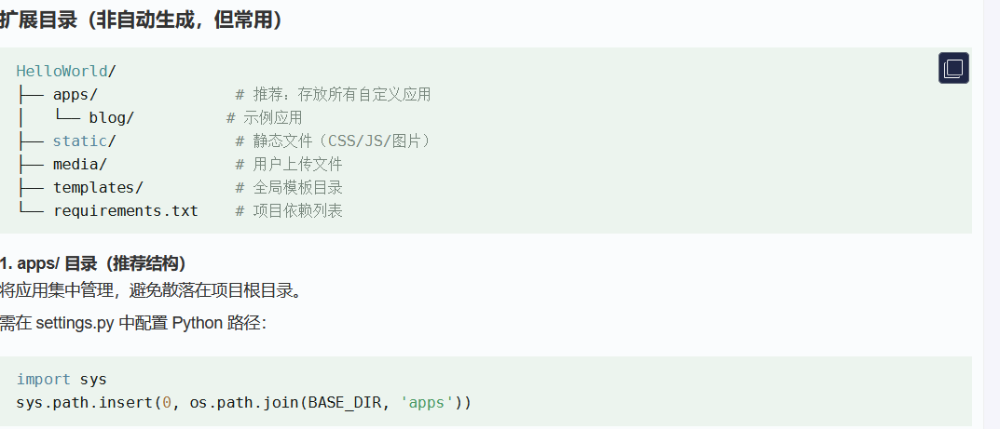

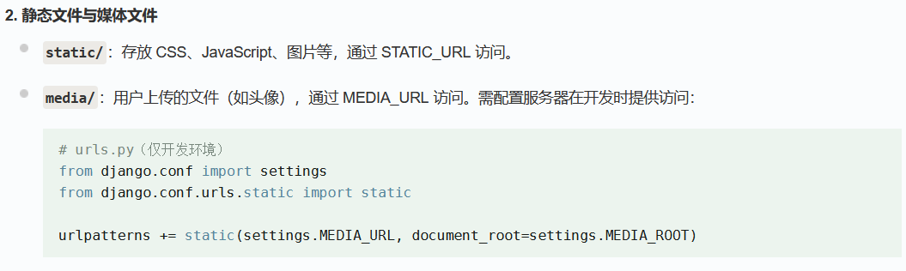

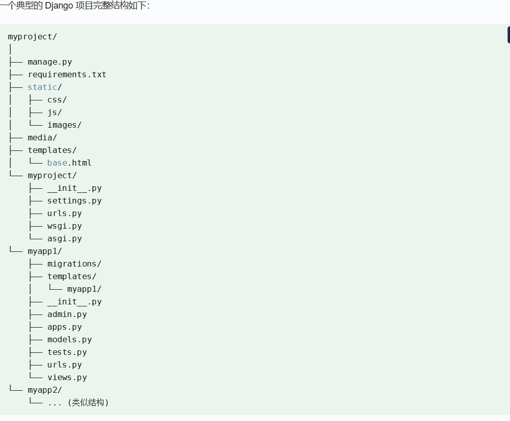

## **`HttpRequest`**对象

[https://docs.djangoproject.com/zh-hans/5.2/ref/request-response](https://docs.djangoproject.com/zh-hans/5.2/ref/request-response)

### method

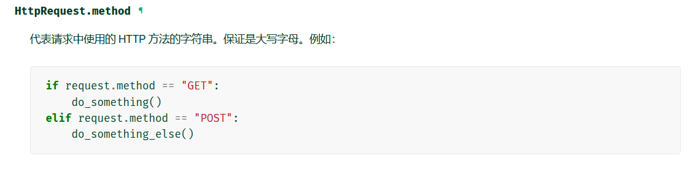

### Get、Post

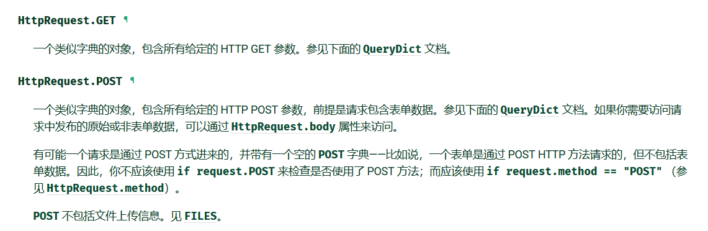

### session

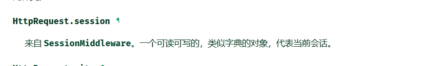

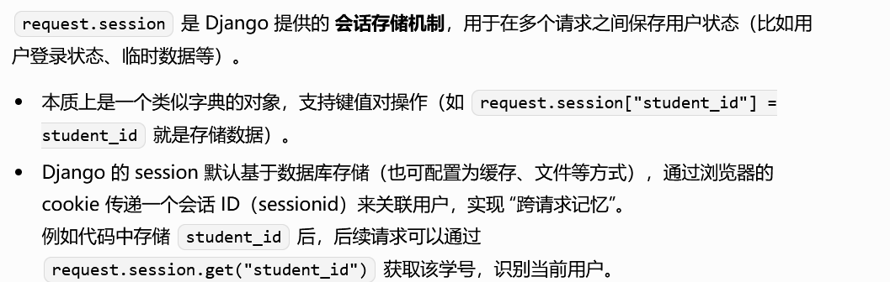

## 注意




name非常重要

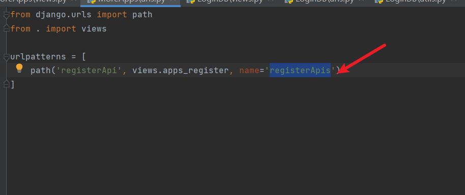
