## 目录结构

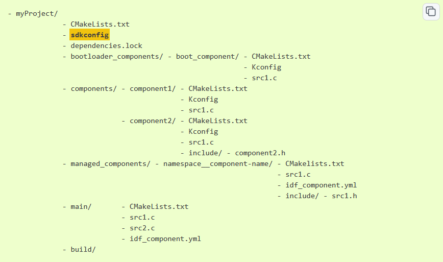

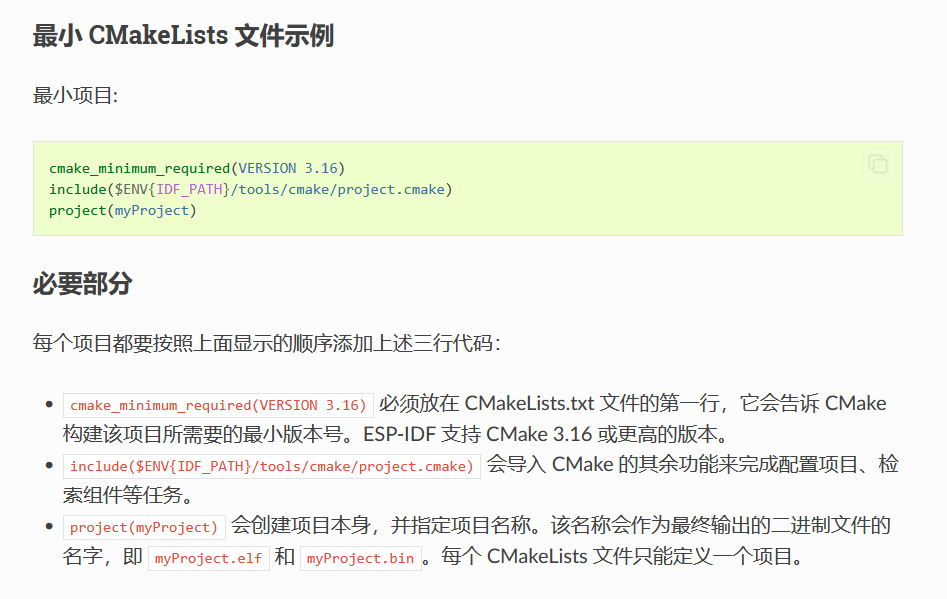

```
# 声明组件的构建信息（ESP-IDF 核心函数）
idf_component_register(
    # 1. 指定当前组件的源文件（.c/.cpp），多个文件用空格分隔
    SRCS 
        "app_main.c"       # 主入口文件
        "wifi_init.c"      # WiFi 初始化模块
        "data_process.c"   # 数据处理模块

    # 2. 指定头文件目录（供当前组件和依赖它的组件引用）
    #    默认为当前目录，如需引用子目录（如 include/）需显式指定
    INCLUDE_DIRS 
        "."                 # 当前目录
        "include"           # 子目录 include/

    # 3. 指定当前组件依赖的其他组件（必须显式声明）
    #    依赖的组件会被优先编译，且其头文件会被自动添加到搜索路径
    REQUIRES 
        esp_wifi            # 依赖 WiFi 组件
        nvs_flash           # 依赖 NVS 存储组件
        esp_netif           # 依赖网络接口组件
        freertos            # 依赖 FreeRTOS 组件

    # 4. 可选：指定当前组件被其他组件依赖时，自动传递的依赖（传递性依赖）
    #    例如：若 A 依赖 B，B 的 PUBLIC_REQUIRES 包含 C，则 A 会自动依赖 C
    PUBLIC_REQUIRES 
        log                 # 日志组件，依赖当前组件的其他组件可直接使用

    # 5. 可选：私有依赖（仅当前组件使用，不传递给依赖它的组件）
    PRIVATE_REQUIRES 
        mbedtls             # 加密组件，仅当前组件内部使用
)

# 可选：添加编译选项（如警告等级、宏定义）
target_compile_options(${COMPONENT_LIB} PRIVATE
    -Wall                  # 开启所有警告
    -Wextra                # 额外警告
    -DDEBUG_MODE=1         # 定义宏 DEBUG_MODE=1
)

# 可选：添加链接选项
target_link_options(${COMPONENT_LIB} PRIVATE
    -Wl,--gc-sections      # 移除未使用的代码段（减小二进制体积）
)
```

## Linux下IDF命令

```
idf.py build                                      编译

idf.py set-target esp32                           设置芯片型号

rm -rf build                                      清除build文件

idf.py menuconfig                                  配置设置

idf.py clean                                       清除编译内容

idf.py fullclean                                   清除编译文件

idf.py -p PORT flash                               烧录

idf.py monitor                                  打开串口

idf.py create-component <component name>           创建新组件

idf.py create-project <project name>                创建新工程

idf.py size                                        查看内存大小

idf.py size-components                              查看详细内存大小

```

## monitor快捷键

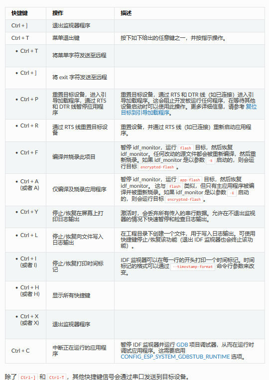

## 外设

### 引脚定义

```

    
    #define GPIO_OUTPUT_IO_0    CONFIG_GPIO_OUTPUT_0
    #define GPIO_OUTPUT_IO_1    CONFIG_GPIO_OUTPUT_1
    #define GPIO_OUTPUT_PIN_SEL  ((1ULL<<GPIO_OUTPUT_IO_0) | (1ULL<<GPIO_OUTPUT_IO_1))

    gpio_config_t io_conf = {};//安全初始化
    io_conf.intr_type = GPIO_INTR_DISABLE;
    io_conf.mode = GPIO_MODE_OUTPUT;
    io_conf.pin_bit_mask = GPIO_OUTPUT_PIN_SEL;
    io_conf.pull_down_en = 0;
    io_conf.pull_up_en = 0;
    gpio_config(&io_conf);

    gpio_set_level(GPIO_OUTPUT_IO_0, 1);
```

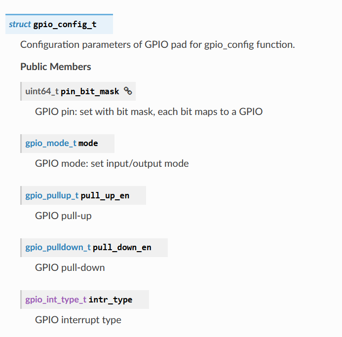

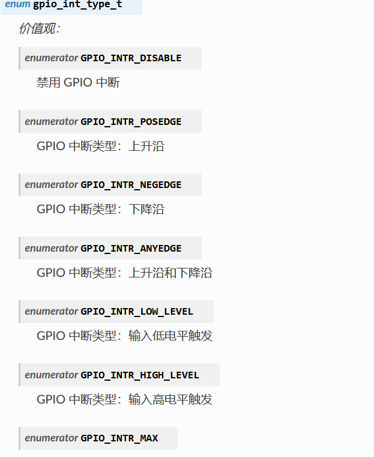

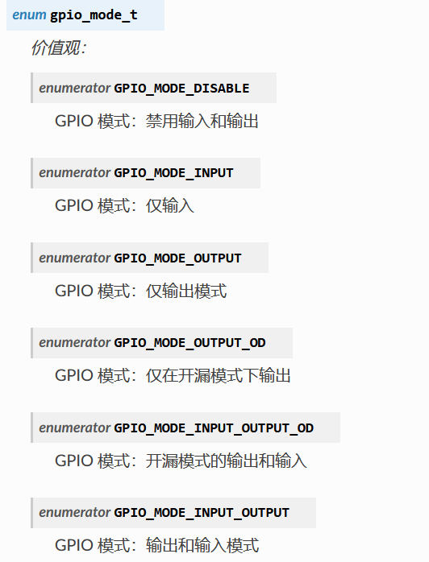

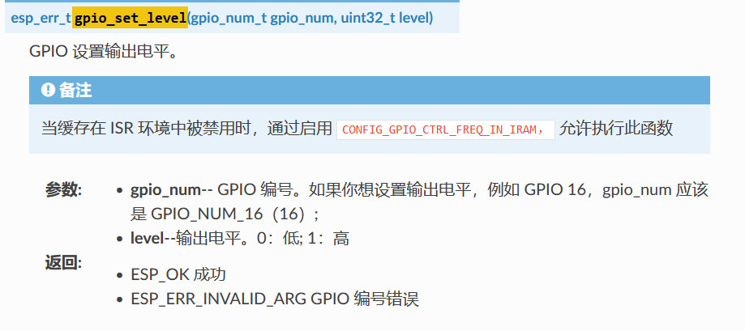

### 引脚中断配置

```
    gpio_set_intr_type(GPIO_INPUT_IO_0, GPIO_INTR_ANYEDGE);
```

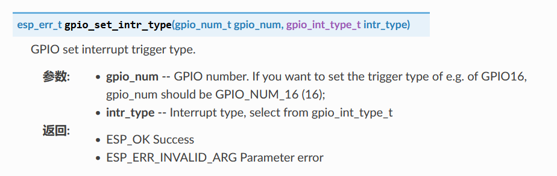

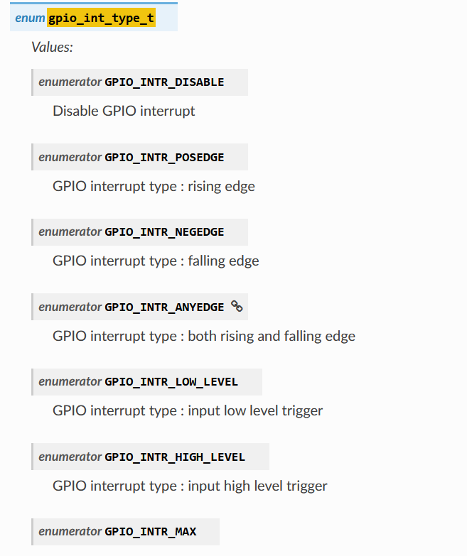

### 中断函数

```
tatic void IRAM_ATTR gpio_isr_handler(void* arg)
{
    uint32_t gpio_num = (uint32_t) arg;
    xQueueSendFromISR(gpio_evt_queue, &gpio_num, NULL);
}
gpio_install_isr_service(ESP_INTR_FLAG_DEFAULT);
//默认中断配置，等效于 ESP_INTR_FLAG_LEVEL1 | ESP_INTR_FLAG_IRAM_SAFE（不同芯片可能有细微差异），适用于大多数场景。
//hook isr handler for specific gpio pin
gpio_isr_handler_add(GPIO_INPUT_IO_0, gpio_isr_handler, (void*) GPIO_INPUT_IO_0);
// void*（通用指针），其设计目的是允许用户向中断处理函数（isr_handler）传递任意类型的参数（可以是整数、结构体指针、数组指针等）
//hook isr handler for specific gpio pin
gpio_isr_handler_add(GPIO_INPUT_IO_1, gpio_isr_handler, (void*) GPIO_INPUT_IO_1);

//remove isr handler for gpio number.
gpio_isr_handler_remove(GPIO_INPUT_IO_0);
//hook isr handler for specific gpio pin again
gpio_isr_handler_add(GPIO_INPUT_IO_0, gpio_isr_handler, (void*) GPIO_INPUT_IO_0);
```

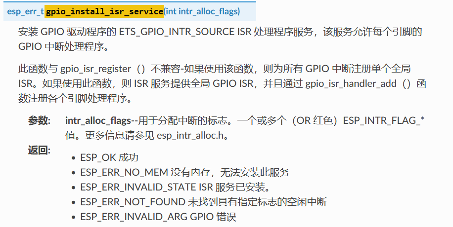

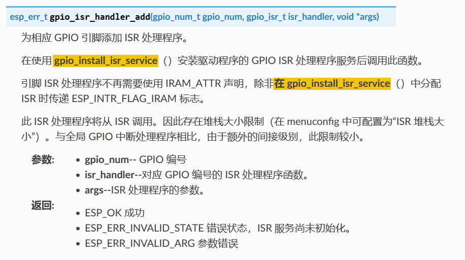

## 系统

### FreeRTOS

```
static QueueHandle_t gpio_evt_queue = NULL;

static void gpio_task_example(void* arg)
{
    uint32_t io_num;
    while(1) 
   {
        if (xQueueReceive(gpio_evt_queue, &io_num, portMAX_DELAY)) {
            printf("GPIO[%"PRIu32"] intr, val: %d\n", io_num, gpio_get_level(io_num));
        }
    }
}
//create a queue to handle gpio event from isr
gpio_evt_queue = xQueueCreate(10, sizeof(uint32_t));
//start gpio task
xTaskCreate(gpio_task_example, "gpio_task_example", 2048, NULL, 10, NULL);
```

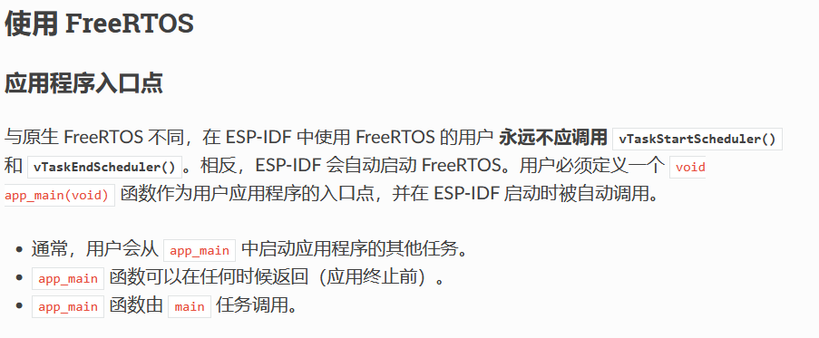

### 任务创建

#### xTaskCreate()

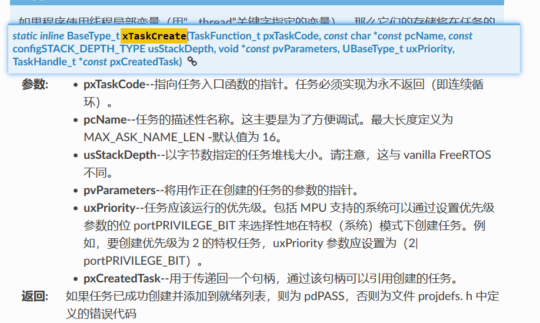

### 队列创建

#### xQueueCreate()

创建队列

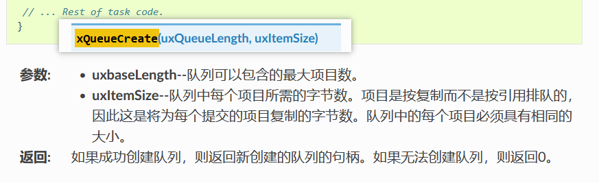

#### xQueueReceive()

从队列中接收数据

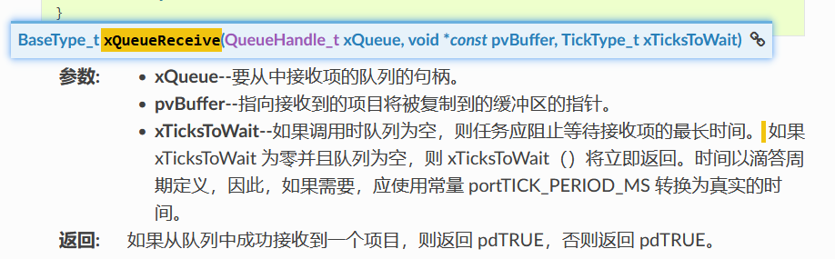

**ticktype 可以分为portMAX\_DELAY(一直等待)、0(不等待)、pdMS\_TO\_TICKS(100)(最长等待时间)** 

#### **`xQueueSend`** 

发送数据到队列

### 事件组

#### xEventGroupWaitBits()

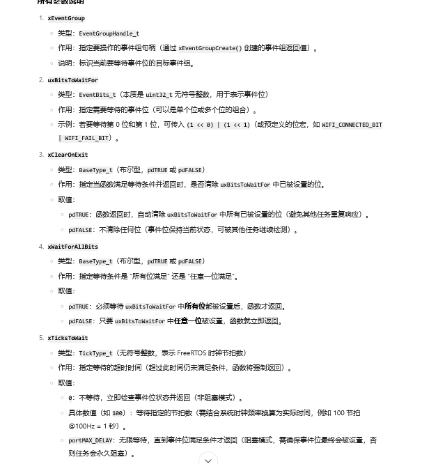

```
static EventGroupHandle_t s_wifi_event_group; //创建实践组
#define WIFI_CONNECTED_BIT BIT0      // STA 连接成功标志
#define WIFI_FAIL_BIT      BIT1      // STA 连接失败标志

xEventGroupSetBits(s_wifi_event_group, WIFI_FAIL_BIT); //置位事件组标志位

s_wifi_event_group = xEventGroupCreate();//创建事件组

EventBits_t bits = xEventGroupWaitBits(s_wifi_event_group,                 //事件组
                                       WIFI_CONNECTED_BIT | WIFI_FAIL_BIT, //标志位
                                       pdFALSE,                            //不清除标志位
                                       pdFALSE,           //不需要所有位都满足，任意一个即可
                                       portMAX_DELAY);                     // 无限等待

if (bits & WIFI_CONNECTED_BIT){
    ESP_LOGI(TAG, "STA 连接成功! AP 热点已开启: SSID=%s", AP_SSID);
} 
else{
  ESP_LOGE(TAG, "STA 连接失败，但 AP 热点仍可用");
}
```

## WIFI

```
nvs_flash_init()                                  开启nvs（wifi配置需要这个函数）

esp_netif_init()                                  初始化接口

esp_event_loop_create_default()                   创建默认事件循环

esp_netif_create_default_wifi_sta()                STA 接口

 esp_netif_create_default_wifi_ap()               AP接口

wifi_init_config_t cfg = WIFI_INIT_CONFIG_DEFAULT()     初始化配置文件

esp_wifi_init(&cfg),为 WiFi 驱动初始化 WiFi 分配资源，如 WiFi 控制结构、RX/TX 缓冲区、WiFi NVS 结构等，这个 WiFi 也启动 WiFi 任务。必须先调用此API，然后才能调用所有其他WiFi API
esp_event_handler_instance_register()              回调函数
esp_wifi_set_mode()                                设置模式
esp_wifi_set_config()                              设置配置
esp_wifi_start()                                   开启wifi
esp_wifi_connect()                                 连接sta
```

### WIFI\_EVENT（WiFi 模块事件）

```
    所属模块：WiFi 驱动（esp_wifi 组件）。
    作用：标识与 WiFi 状态相关的事件（如连接、断开、启动、停止等）。
    典型事件 ID：
        WIFI_EVENT_STA_START：STA 模式（客户端）启动成功；
        WIFI_EVENT_STA_STOP：STA 模式停止；
        WIFI_EVENT_STA_CONNECTED：STA 成功连接到 AP（路由器）；
        WIFI_EVENT_STA_DISCONNECTED：STA 与 AP 断开连接；
        WIFI_EVENT_AP_START：AP 模式（热点）启动成功；
        WIFI_EVENT_AP_STOP：AP 模式停止；
        WIFI_EVENT_AP_STACONNECTED：有设备连接到 ESP32 的 AP；
        WIFI_EVENT_AP_STADISCONNECTED：设备从 ESP32 的 AP 断开。
        ESP_EVENT_ANY_ID  全部ID事件

2. IP_EVENT（IP 协议栈事件）

    所属模块：TCP/IP 协议栈（lwip 组件）。
    作用：标识与 IP 地址分配、释放相关的事件。
    典型事件 ID：
        IP_EVENT_STA_GOT_IP：STA 模式下从路由器获取到 IP 地址；
        IP_EVENT_STA_LOST_IP：STA 模式下丢失 IP 地址；
        IP_EVENT_AP_STAIPASSIGNED：ESP32 的 AP 模式为连接的设备分配了 IP 地址；
        IP_EVENT_GOT_IP6：获取到 IPv6 地址。

3. BT_EVENT（经典蓝牙事件）

    所属模块：经典蓝牙（BR/EDR）驱动（bt 组件）。
    作用：标识与经典蓝牙相关的事件（如启动、连接、数据传输等）。
    典型事件 ID：
        BT_EVENT_ENABLED：经典蓝牙启动成功；
        BT_EVENT_DISABLED：经典蓝牙关闭；
        BT_EVENT_SPP_CONNECTED：SPP（串口协议）连接建立；
        BT_EVENT_SPP_DISCONNECTED：SPP 连接断开。

4. BLE_EVENT（低功耗蓝牙 BLE 事件）

    所属模块：BLE 驱动（bt 组件）。
    作用：标识与 BLE 相关的事件（如广播、连接、GATT 交互等）。
    典型事件 ID：
        BLE_EVENT_ENABLED：BLE 启动成功；
        BLE_EVENT_DISABLED：BLE 关闭；
        BLE_EVENT_CONNECTED：BLE 连接建立；
        BLE_EVENT_DISCONNECTED：BLE 连接断开；
        BLE_EVENT_GATT_WRITE：GATT 服务收到写入请求。

5. ETH_EVENT（以太网事件）

    所属模块：以太网驱动（ethernet 组件）。
    作用：标识与以太网相关的事件（如连接、断开、获取 IP 等）。
    典型事件 ID：
        ETH_EVENT_CONNECTED：以太网物理连接建立；
        ETH_EVENT_DISCONNECTED：以太网物理连接断开；
        ETH_EVENT_GOT_IP：以太网接口获取到 IP 地址。

6. HTTP_CLIENT_EVENTS（HTTP 客户端事件）

    所属模块：HTTP 客户端（esp_http_client 组件）。
    作用：标识 HTTP 客户端请求过程中的事件（如连接、数据接收、请求完成等）。
    典型事件 ID：
        HTTP_EVENT_ON_CONNECTED：与服务器建立连接；
        HTTP_EVENT_ON_DATA：收到服务器返回的数据；
        HTTP_EVENT_ON_FINISH：HTTP 请求完成；
        HTTP_EVENT_ON_DISCONNECTED：与服务器断开连接。

7. HTTP_SERVER_EVENTS（HTTP 服务器事件）

    所属模块：HTTP 服务器（esp_http_server 组件）。
    作用：标识 HTTP 服务器运行中的事件（如客户端连接、请求处理等）。
    典型事件 ID：
        HTTP_SERVER_EVENT_START：服务器启动成功；
        HTTP_SERVER_EVENT_STOP：服务器停止；
        HTTP_SERVER_EVENT_CONNECTED：客户端连接到服务器。

8. 其他组件事件
根据使用的组件不同，还可能有其他事件基础，例如：

    NVS_EVENTS：NVS 存储相关事件（如擦除、错误等）；
    SPIFFS_EVENTS：SPIFFS 文件系统事件；
    MQTT_EVENTS：MQTT 客户端事件（如连接、断开、消息接收等）
```

```

#include "include/wifis.h"
#include "include/Html_index.h"
#include "MyMqtt.h"
#include <stdio.h>
#include "esp_wifi.h"
#include "esp_event.h"
#include "esp_event_base.h"
#include "esp_mac.h"
#include "esp_log.h"
#include "esp_netif.h"
#include "esp_netif_sntp.h"
#include "esp_http_server.h"
#include "cJSON.h"
#include "string.h"
#include "nvs.h"
#include "nvs_flash.h"
#include "freertos/FreeRTOS.h"
#include "freertos/task.h"
#include "freertos/event_groups.h"
#include "driver/rmt_encoder.h"
// #include "UI_custom/gui_guider.h"

#define MAX_RETRY    5               // STA 连接最大重试次数

static const char *TAG = "AP+STA Demo";
static EventGroupHandle_t s_wifi_event_group;

#define WIFI_CONNECTED_BIT BIT0      // STA 连接成功标志
#define WIFI_FAIL_BIT      BIT1      // STA 连接失败标志
#define WIFI_AP_BIT      BIT2      // STA 连接失败标志

static int s_retry_count = 0;
int g_ap_connected_num = 0;   // 连接到 AP 的设备数量
static const char* OK_text = "light";

static uint8_t state_JDQ = 0;

/*------------------ 用户变量全局变量定义 ------------------*/
unsigned char* STA_SSID;
unsigned char* STA_PASSWORD;
unsigned char* AP_SSID;
unsigned char* AP_PASSWORD;
unsigned char STA_IP[4]={0};
Wifi_States Wifi_State;

/*------------------ 事件处理函数 ------------------*/
static void wifi_event_handler(void* arg, esp_event_base_t event_base, 
                               int32_t event_id, void* event_data) {
    // STA 事件处理
    if (event_base == WIFI_EVENT) {
        switch (event_id) {
            case WIFI_EVENT_STA_START:
                espnow_init();
                esp_wifi_connect(); // STA 启动后自动连接
                break;
            case WIFI_EVENT_STA_DISCONNECTED:
                if (s_retry_count < MAX_RETRY) {
                    esp_wifi_connect();
                    s_retry_count++;
                    ESP_LOGI(TAG, "STA 断开，正在重连... (%d/%d)", s_retry_count, MAX_RETRY);
                } else {
                    xEventGroupSetBits(s_wifi_event_group, WIFI_FAIL_BIT);
                }
                break;
            case WIFI_EVENT_AP_STACONNECTED: // AP 有设备连接
                g_ap_connected_num++;
                wifi_event_ap_staconnected_t* event = (wifi_event_ap_staconnected_t*) event_data;
                ESP_LOGI(TAG,"station" MACSTR "leave",MAC2STR(event->mac));
                xEventGroupSetBits(s_wifi_event_group, WIFI_AP_BIT);
                break;
            case WIFI_EVENT_AP_STADISCONNECTED: 
                if (g_ap_connected_num > 0) {
                    g_ap_connected_num--;
                }
                ESP_LOGI(TAG, "设备断开AP，当前总数：%d", g_ap_connected_num);
                // 断开后的业务逻辑（如清理该设备的缓存）
                break;
        }
    }
    // IP 事件处理
    else if (event_base == IP_EVENT && event_id == IP_EVENT_STA_GOT_IP) {
        ip_event_got_ip_t* ip_event = (ip_event_got_ip_t*) event_data;
        STA_IP[0] = esp_ip4_addr1_16(&ip_event->ip_info.ip);
        STA_IP[1] = esp_ip4_addr2_16(&ip_event->ip_info.ip);
        STA_IP[2] = esp_ip4_addr3_16(&ip_event->ip_info.ip);
        STA_IP[3] = esp_ip4_addr4_16(&ip_event->ip_info.ip);
        ESP_LOGI(TAG, "STA 获取 IP: " IPSTR, IP2STR(&ip_event->ip_info.ip));
        s_retry_count = 0;
        xEventGroupSetBits(s_wifi_event_group, WIFI_CONNECTED_BIT);
    }
}

static void Wificonfig_AP(void)
{
    ESP_ERROR_CHECK(esp_wifi_stop());
    Wifi_State = WIFI_STATE_NULL;
    // 5. 配置 AP 参数
    wifi_config_t ap_config = {
        .ap = {
            .ssid = {0},
            .password ={0},
            .max_connection = 20,         // 最大连接数
            .channel = 6,
            .authmode = WIFI_AUTH_WPA2_PSK
        }
    };
    strlcpy((char*)ap_config.ap.ssid, (const char*)AP_SSID, sizeof(ap_config.ap.ssid));
    strlcpy((char*)ap_config.ap.password, (const char*)AP_PASSWORD, sizeof(ap_config.ap.password));

    ESP_ERROR_CHECK(esp_wifi_set_config(WIFI_IF_AP, &ap_config));
}

static void Wificonifg_STA(void)
{
    ESP_ERROR_CHECK(esp_wifi_stop());
    Wifi_State = WIFI_STATE_NULL;
    // 6. 配置 STA 参数
    wifi_config_t sta_config = {
        .sta = {
            .ssid = {0},
            .password = {0}
        }
    };
    strlcpy((char*)sta_config.sta.ssid, (const char*)STA_SSID, sizeof(sta_config.sta.ssid));
    strlcpy((char*)sta_config.sta.password, (const char*)STA_PASSWORD, sizeof(sta_config.sta.password));

    ESP_ERROR_CHECK(esp_wifi_set_config(WIFI_IF_STA, &sta_config));
}

/*------------------ WiFi 初始化函数 ------------------*/
void wifi_init_apsta(void) {
    // 1. 初始化基础组件
    // ESP_ERROR_CHECK(nvs_flash_init());
    ESP_ERROR_CHECK(esp_netif_init());

    ESP_ERROR_CHECK(esp_event_loop_create_default());
    
    // 2. 创建默认网络接口
    esp_netif_create_default_wifi_sta(); // STA 接口
    // AP 接口
    esp_netif_create_default_wifi_ap();
    // 3. 初始化 WiFi 驱动
    wifi_init_config_t cfg = WIFI_INIT_CONFIG_DEFAULT();
    ESP_ERROR_CHECK(esp_wifi_init(&cfg));

    // 4. 注册事件回调
    esp_event_handler_instance_register(WIFI_EVENT, ESP_EVENT_ANY_ID, wifi_event_handler, NULL, NULL);
    esp_event_handler_instance_register(IP_EVENT, IP_EVENT_STA_GOT_IP, wifi_event_handler, NULL, NULL);

    // 7. 设置双模式并启动
    ESP_ERROR_CHECK(esp_wifi_set_mode(WIFI_MODE_APSTA));

    Wificonfig_AP();
    Wificonifg_STA();

    ESP_ERROR_CHECK(esp_wifi_start());

}
```

## WebSocket

### 创建http服务实例

```
static httpd_handle_t start_webserver(void) {
    // 配置HTTP服务器
    httpd_config_t config = HTTPD_DEFAULT_CONFIG();
    httpd_handle_t server = NULL;

    // 启动HTTP服务器
    if (httpd_start(&server, &config) == ESP_OK) {
        // 注册根路径（/）的处理函数
        httpd_uri_t index_uri = {
            .uri       = "/",
            .method    = HTTP_GET,
            .handler   = index_handler,
            .user_ctx  = NULL
        };
        httpd_register_uri_handler(server, &index_uri);

        // 注册状态更新路径（/set）的处理函数
        httpd_uri_t set_uri = {
            .uri       = "/set",
            .method    = HTTP_GET,
            .handler   = set_handler,
            .user_ctx  = NULL
        };
        httpd_register_uri_handler(server, &set_uri);
    }

    return server;
}
```

### 接收到请求后

```
static esp_err_t index_handler(httpd_req_t *req) {
    // 发送HTML内容给客户端
    httpd_resp_send(req, index_html, HTTPD_RESP_USE_STRLEN);
    return ESP_OK;
}

// 2. 处理状态更新请求（/set?state=xxx）
static esp_err_t set_handler(httpd_req_t *req) {
    char buf[1024] = {0};
    // 将数据存入buf
    ssize_t recv_size = httpd_req_recv(req, buf, sizeof(buf)-1);
    ESP_LOGI(TAG, "接收到的数据: %s", buf);
    //解析对象
    cJSON *root = cJSON_Parse(buf);
    //获取节点数据
    cJSON *cod = cJSON_GetObjectItem(root, "cod");
    cJSON *text = cJSON_GetObjectItem(root, "text");
    //打印节点数据
    ESP_LOGI(TAG, "cod: %s, text: %s", cod->valuestring, text->valuestring);
    // 1. 设置响应类型为 JSON（必须，否则客户端可能无法正确解析）
    httpd_resp_set_type(req, "application/json");
    // 2. 构造 JSON 格式的字符串（示例：包含状态和消息字段）
    const char* json_resp = "{\"status\": \"OK\", \"message\": \"操作成功\", \"code\": 200}";
    // 3. 发送 JSON 响应（使用 HTTPD_RESP_USE_STRLEN 自动计算长度）
    httpd_resp_send(req, json_resp, HTTPD_RESP_USE_STRLEN);
    return ESP_OK;
}
```

## I2C

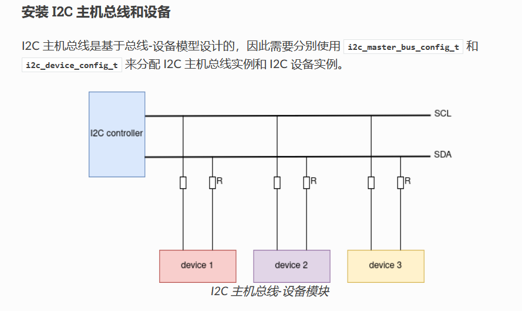

### i2c\_master\_bus\_config\_t

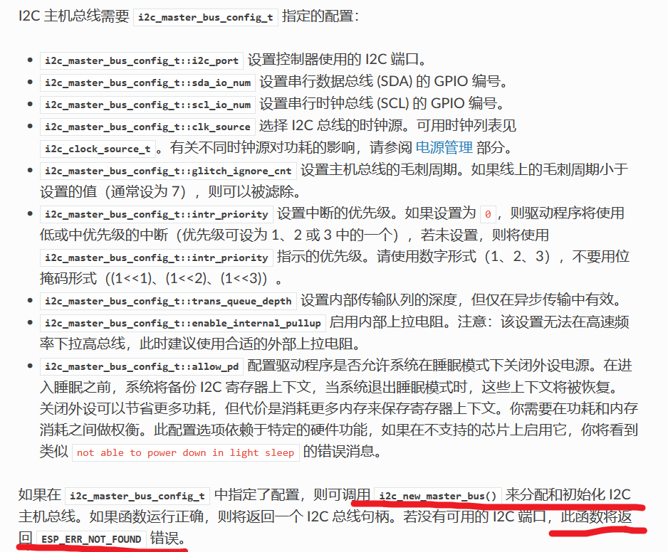

### i2c\_device\_config\_t

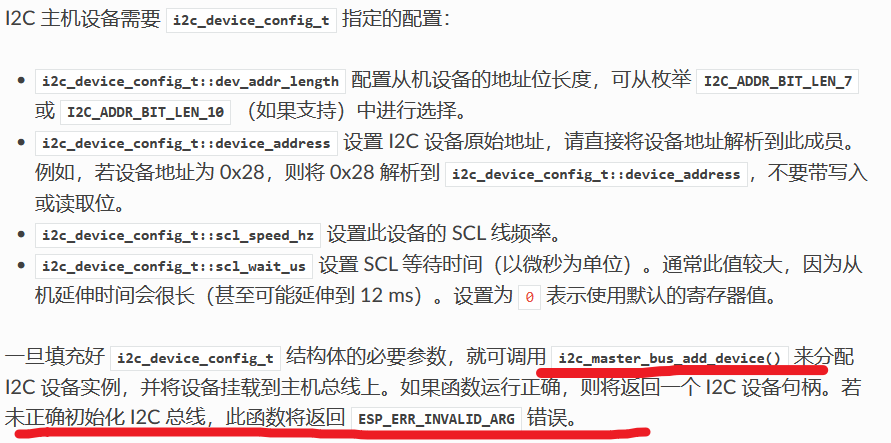

### 例程

```
static void i2c_master_init(i2c_master_bus_handle_t *bus_handle, i2c_master_dev_handle_t *dev_handle)
{
    i2c_master_bus_config_t bus_config = {
        .i2c_port = I2C_MASTER_NUM,
        .sda_io_num = I2C_MASTER_SDA_IO,
        .scl_io_num = I2C_MASTER_SCL_IO,
        .clk_source = I2C_CLK_SRC_DEFAULT,
        .glitch_ignore_cnt = 7,
        .flags.enable_internal_pullup = true,
    };
    ESP_ERROR_CHECK(i2c_new_master_bus(&bus_config, bus_handle));

    i2c_device_config_t dev_config = {
        .dev_addr_length = I2C_ADDR_BIT_LEN_7,
        .device_address = CST816T_ADDR,
        .scl_speed_hz = I2C_MASTER_FREQ_HZ,
    };
    
    ESP_ERROR_CHECK(i2c_master_bus_add_device(*bus_handle, &dev_config, dev_handle));
}
```

### 主机写入

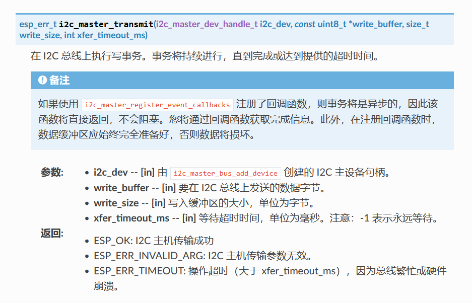

```
static esp_err_t CST816T_register_write_byte(i2c_master_dev_handle_t dev_handle, uint8_t reg_addr, uint8_t data)
{
    uint8_t write_buf[2] = {reg_addr, data};
    return i2c_master_transmit(dev_handle, write_buf, sizeof(write_buf), I2C_MASTER_TIMEOUT_MS / portTICK_PERIOD_MS);
}
```

### 主机读取

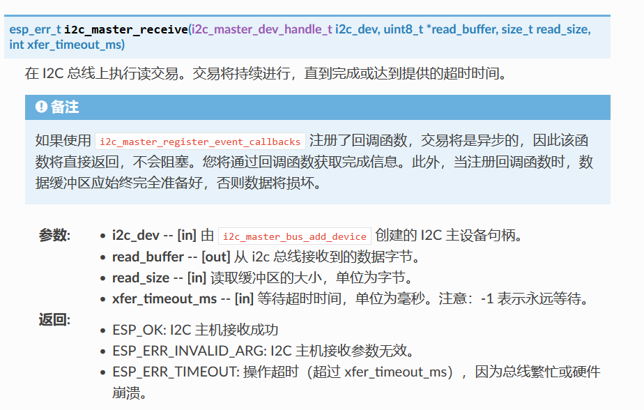

```
static esp_err_t CST816T_register_read(i2c_master_dev_handle_t dev_handle, uint8_t reg_addr, uint8_t *data, size_t len)
{
    return i2c_master_transmit_receive(dev_handle, &reg_addr, 1, data, len, I2C_MASTER_TIMEOUT_MS / portTICK_PERIOD_MS);
}
```

## I2S

## LVGL

```
idf.py add-dependency "lvgl/lvgl^8.3.0"
```

先设置屏幕缓冲区

```
// 屏幕分辨率（根据你的 ST7789V 屏幕修改，如 240x240 或 240x320）
#define LCD_HOR_RES 240
#define LCD_VER_RES 320

TaskHandle_t led_task_Handler = NULL;
static lv_disp_draw_buf_t draw_buf;
static lv_color_t buf[LCD_HOR_RES * LCD_VER_RES / 4];  // 240*240/4 = 14400 像素 → 28800 字节
```

设置LVGL时钟用来检测触摸和动画

```
static esp_timer_handle_t lvgl_tick_timer = NULL;
 
// 定时回调函数，每 1ms 触发
static void lv_tick_task(void *arg) {
    lv_tick_inc(1);
}
 
// 初始化 LVGL Tick 定时器
void lvgl_tick_timer_init(void) {
    const esp_timer_create_args_t timer_args = {
        .callback = &lv_tick_task,
        .arg = NULL,
        .dispatch_method = ESP_TIMER_TASK,
        .name = "lv_tick_timer"
    };
 
    esp_timer_create(&timer_args, &lvgl_tick_timer);
    esp_timer_start_periodic(lvgl_tick_timer, 1000); // 1ms 触发
}
```

设置屏幕初始化和屏幕回调函数

```
/**
 * @brief LVGL 刷新回调：将指定区域的像素数据发送到 ST7789V
 * @param disp: LVGL 显示驱动句柄
 * @param area: 需要刷新的区域（x1, y1 到 x2, y2）
 * @param color_p: 该区域的像素数据（RGB565 格式）
 */
static void my_disp_flush(lv_disp_drv_t *disp, const lv_area_t *area, lv_color_t *color_p) {
    uint16_t width = area->x2 - area->x1 ;
    uint16_t height = area->y2 - area->y1 ;
    Lp_x = area->x1;
    Lp_y = area->y1;
    
    Lv_x =  area->x2;
    Lv_y =  area->y2;

    L_h = height;
    L_w = width;
    LCD_SetWindows(area->x1, area->y1, area->x2, area->y2);
    LCD_ShowPicture_16b_s(area->x1, area->y1 ,width+1, height+1,(uint16_t *)&color_p->full);
    lv_disp_flush_ready(disp);
}
/**
 * @brief 初始化 LVGL 及显示驱动
 */
static void lvgl_init(void) {
    // 1. 初始化 LVGL 核心库
    lv_init();
    // 2. 初始化显示缓冲区
    lv_disp_draw_buf_init(&draw_buf, buf, NULL, LCD_HOR_RES * LCD_VER_RES / 4);
    // 3. 配置显示驱动参数
    static lv_disp_drv_t disp_drv;
    lv_disp_drv_init(&disp_drv);  // 初始化驱动结构体
        // 设置屏幕分辨率
    disp_drv.hor_res = LCD_HOR_RES;
    disp_drv.ver_res = LCD_VER_RES;
    // 绑定缓冲区和刷新回调
    disp_drv.draw_buf = &draw_buf;
    disp_drv.flush_cb = my_disp_flush;  // 关键：绑定我们实现的刷新函数
    lv_disp_drv_register(&disp_drv);  // 关键：保存显示设备句柄
}
```

设置触摸屏初始化和回调函数

```
static int32_t last_x = 0;  // 记录上次坐标（松开时沿用）
static int32_t last_y = 0;
/**
 * @brief LVGL 刷新回调：将指定触摸点的数据传递给 LVGL
 * @param disp: LVGL 显示驱动句柄
 * @param area: 需要刷新的区域（x1, y1 到 x2, y2）
 * @param color_p: 该区域的像素数据（RGB565 格式）
 */
static void touchpad_read(lv_indev_drv_t * indev_drv, lv_indev_data_t * data) {
    int32_t raw_x, raw_y;
    int32_t lcd_x, lcd_y;

    // 读取原始触摸数据
    if (!IsTouchPressed()) {
        // 转换为LCD坐标（校准）
        data->state = LV_INDEV_STATE_PRESSED;  // 按下状态
    } else {
        data->state = LV_INDEV_STATE_RELEASED;  // 松开状态
    }

    // 填充坐标（松开时使用上次坐标）
    data->point.x = touch.X;
    data->point.y = touch.Y;
    // printf("1\r\n");

    last_x = touch.X;
    last_y = touch.Y;
}

/**
 * @brief 初始化 LVGL触摸驱动
 */
void lv_touch_init(void) {

    static lv_indev_drv_t indev_drv;  // 输入设备驱动结构体

    // 初始化驱动
    lv_indev_drv_init(&indev_drv);
    indev_drv.type = LV_INDEV_TYPE_POINTER;  // 类型：指针设备（触摸屏）
    indev_drv.read_cb = touchpad_read;       // 绑定读取回调

    // 注册设备（返回设备句柄，可用于后续配置）
    touch_indev = lv_indev_drv_register(&indev_drv);

}
```

## lvgl页面设置

使用NXP的GUI-Guider-1.10.0-GA软件绘制页面

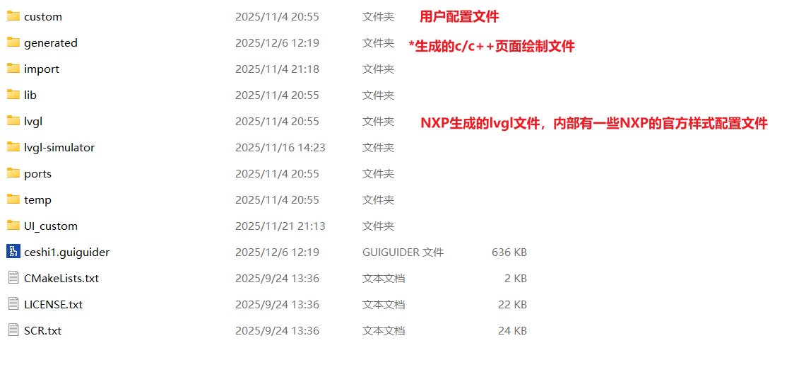

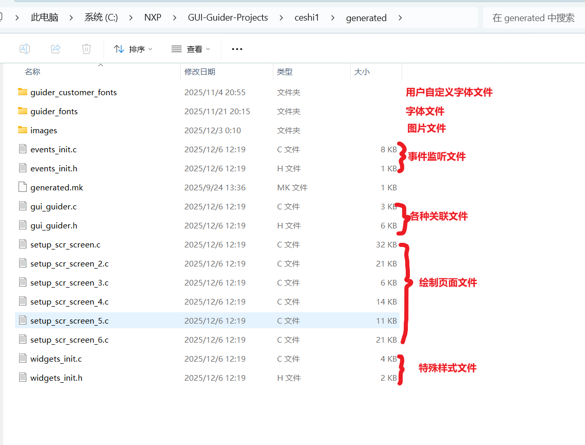

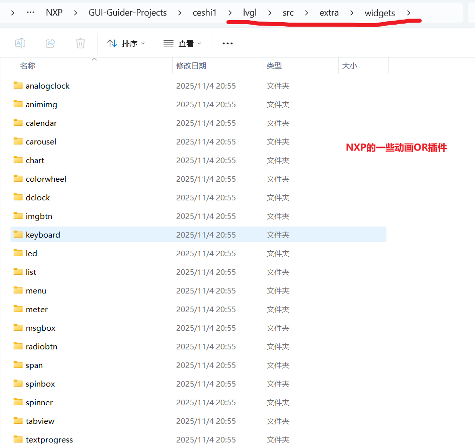

## lvgl增加帧率

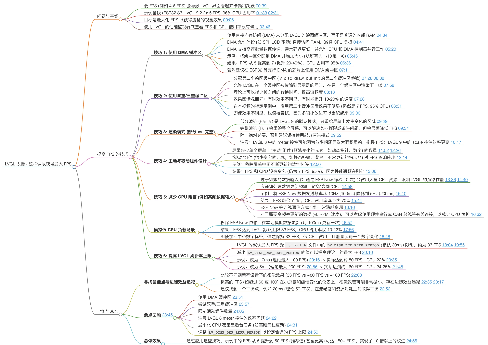

```
LV_USE_PERF_MONITOR 设置为1开启帧率显示
lv_obj_set_style_text_font(label, &lv_font_montserrat_8, 0); // 使用 8px 字体字体设置可放主函数
LV_DISP_DEF_REFR_PERIOD 设置帧率
```

## lvgl设置屏幕双缓存

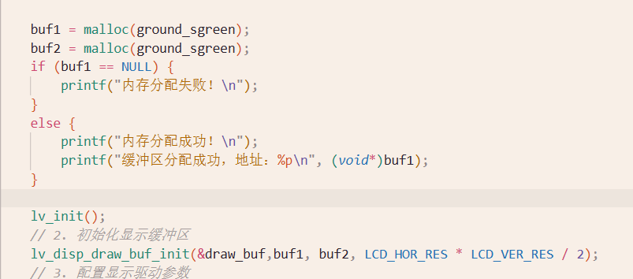

## MQTT

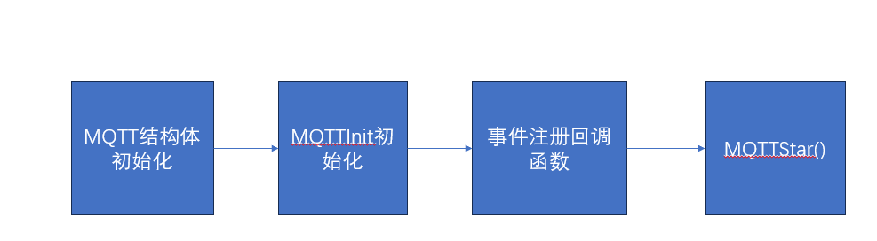

```
void mqtt_app_start(void)
{
    esp_mqtt_client_config_t mqtt_cfg = {
        .broker.address.uri = CONFIG_BROKER_URL,
    };
    client = esp_mqtt_client_init(&mqtt_cfg);

    esp_mqtt_client_register_event(client, ESP_EVENT_ANY_ID, mqtt_event_handler, NULL);
    esp_mqtt_client_start(client);

}
```

### esp\_mqtt\_client\_publish

### esp\_mqtt\_client\_subscribe

### event\_id

### esp\_mqtt\_event\_handle\_t

### esp\_mqtt\_client\_handle\_t

## ESP\_NOW


```
    // 2. 初始化ESP-NOW
    ESP_ERROR_CHECK(esp_now_init());
    // 3. 注册发送/接收回调
    ESP_ERROR_CHECK(esp_now_register_send_cb(espnow_send_cb));
    ESP_ERROR_CHECK(esp_now_register_recv_cb(espnow_recv_cb));
    // 4. 设置主密钥（所有设备必须一致）
    // ESP_ERROR_CHECK(esp_now_set_pmk((uint8_t *)ESPNOW_PMK));
    // 5. 添加广播对等体（用于发送发现包）

    uint8_t broadcast_mac[ESP_NOW_ETH_ALEN] = {0xFF, 0xFF, 0xFF, 0xFF, 0xFF, 0xFF};
    add_peer_if_not_exists(broadcast_mac);
    ESP_LOGI(TAG, "ESP-NOW初始化完成（主设备模式）");

    xTaskCreate(master_task, "master_task", 4096, NULL, 5, NULL);
    ESP_LOGI(TAG, "主设备启动完成，等待从设备注册...");
```

接收回调

```
 * @brief ESP-NOW接收回调（处理从设备的注册包、心跳响应）
 * @param recv_info 接收信息（源MAC、目标MAC）
 * @param data 接收的数据
 * @param len 数据长度
 */
static void espnow_recv_cb(const esp_now_recv_info_t *recv_info, const uint8_t *data, int len) {
    if (recv_info == NULL || data == NULL || len < sizeof(espnow_packet_t)) {
        ESP_LOGE(TAG, "接收回调参数无效（长度：%d）", len);
        return;
    }
    espnow_packet_t *pkg = (espnow_packet_t *)data;
    uint16_t crc_cal = 0;
    uint16_t crc_pkg = pkg->crc;

    // 1. CRC校验（确保数据未损坏）
    pkg->crc = 0; // 清空CRC字段后重新计算
    crc_cal = espnow_crc16((uint8_t *)pkg, len);
    if (crc_cal != crc_pkg) {
        ESP_LOGE(TAG, "CRC校验失败");
        return;
    }

    // 2. 根据数据包类型处理
    switch (pkg->type) {
        case DATA_TYPE_REGISTER: {
            // 收到从设备注册包 → 添加到列表
            ESP_LOGI(TAG, "收到从设备注册请求：");
            print_mac(pkg->src_mac);
            slave_list_add(pkg->src_mac);
            break;
        }
        case DATA_TYPE_HEARTBEAT: {
            // 收到从设备心跳响应 → 更新最后响应时间
            int idx = slave_list_find(pkg->src_mac)+1;
            if (idx) {
                s_slave_list[idx-1].last_heartbeat = esp_timer_get_time() / 1000;
                printf("收到心跳响应:");
                print_mac(pkg->src_mac);
            }
            break;
        }
        default:
            ESP_LOGW(TAG, "收到未知类型数据包：%d", pkg->type);
            break;
    }
}
```

若要广播则需要将MAC地址设置为{0xFF, 0xFF, 0xFF, 0xFF, 0xFF, 0xFF}

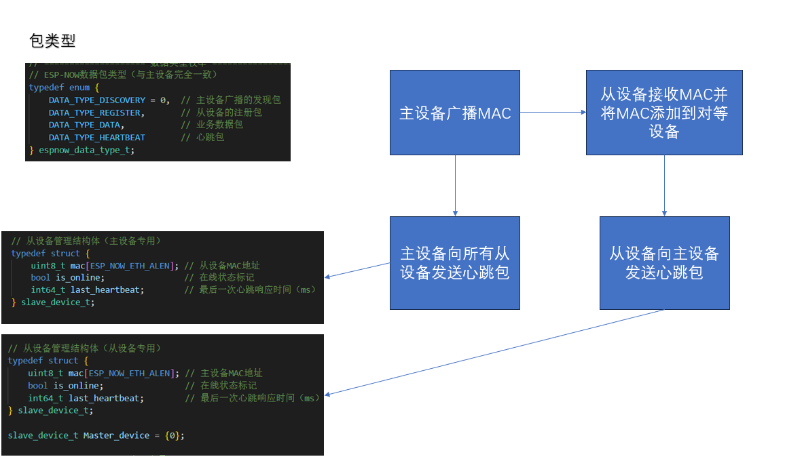

核心结构

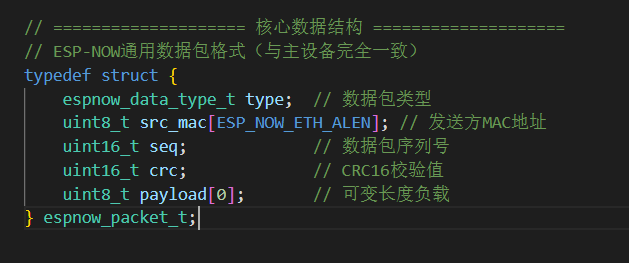
