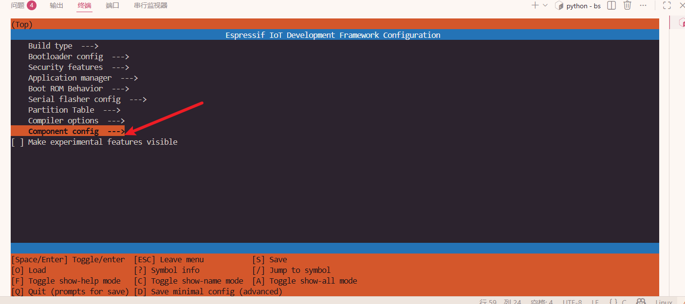
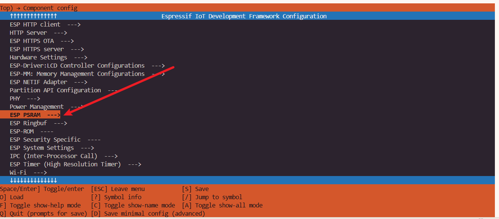
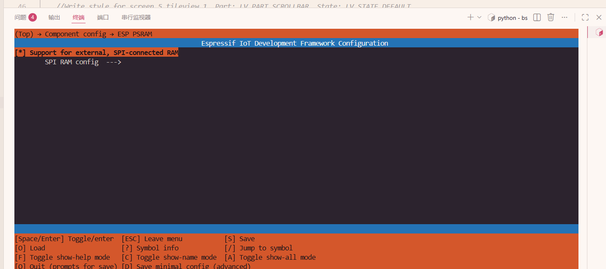
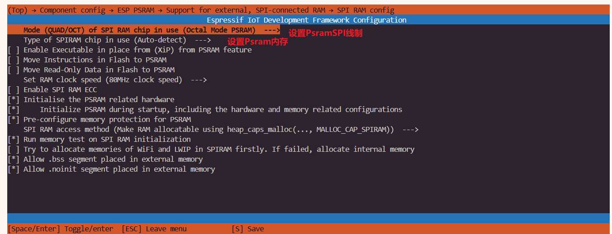
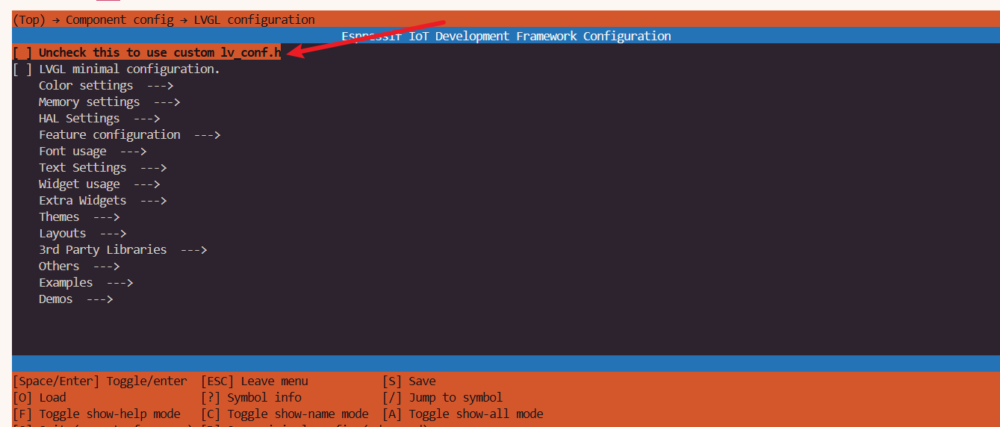
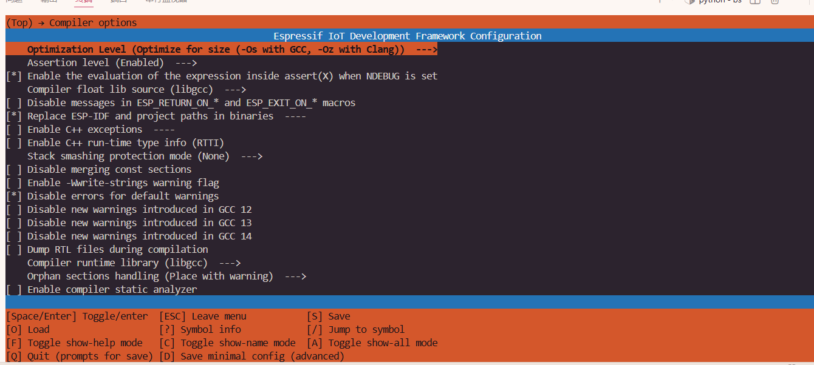
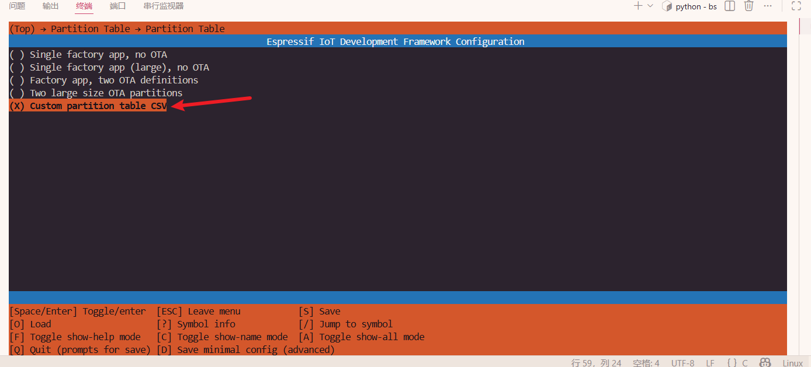
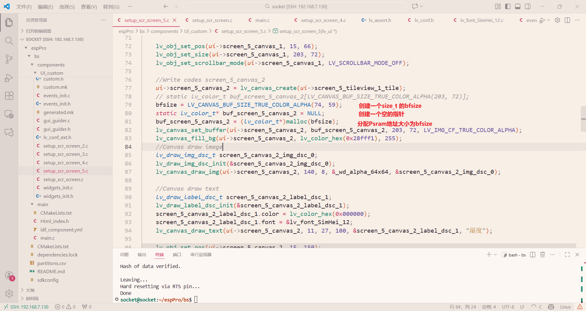

## 先开启Psram

```
idf.py menuconfig
```









LVG配置



编译等级设置



配置scv分配flash



```
# Name,   Type, SubType, Offset,  Size, Flags
# 系统必要分区（以下是数据行，字段后无注释）
nvs,      data, nvs,     0x9000,  0x4000,   
otadata,  data, ota,     0xd000,  0x2000,    
app0,     app,  0x10,    0x10000, 0xA00000, 
spiffs,   data, spiffs,  ,        0x300000,  
```

在根目录cmk文件设置scv

```
# The following five lines of boilerplate have to be in your project's
# CMakeLists in this exact order for cmake to work correctly
cmake_minimum_required(VERSION 3.16)

include($ENV{IDF_PATH}/tools/cmake/project.cmake)

set(partition_table "partitions.csv")
# 若分区表文件不在根目录，需写相对路径（如 partitions/partitions.csv）
# set(partition_table "partitions/partitions.csv")

# 关键：指定自定义分区表的路径（项目根目录的 partitions.csv）
set(PARTITION_TABLE_FILE "partitions.csv")
# 可选：指定分区表的偏移量（默认 0x8000，无需修改，除非有特殊需求）
set(PARTITION_TABLE_OFFSET "0x8000")
# 可选：指定分区表的大小（默认 0x1000，即 4KB，无需修改）
set(PARTITION_TABLE_SIZE "0x1000")

# "Trim" the build. Include the minimal set of components, main, and anything it depends on.
# idf_build_set_property(MINIMAL_BUILD ON)
project(bs)
```

lvgl.config配置开启Psram

```

/*1: use custom malloc/free, 0: use the built-in `lv_mem_alloc()` and `lv_mem_free()`*/
#define LV_MEM_CUSTOM 1
#if LV_MEM_CUSTOM == 0
    /*Size of the memory available for `lv_mem_alloc()` in bytes (>= 2kB)*/
    #define LV_MEM_SIZE (128U * 1024U)          /*[bytes]*/

    /*Set an address for the memory pool instead of allocating it as a normal array. Can be in external SRAM too.*/
    #define LV_MEM_ADR 0     /*0: unused*/
    /*Instead of an address give a memory allocator that will be called to get a memory pool for LVGL. E.g. my_malloc*/
    #if LV_MEM_ADR == 0
        #undef LV_MEM_POOL_INCLUDE
        #undef LV_MEM_POOL_ALLOC
    #endif

#else       /*LV_MEM_CUSTOM*/
    #define LV_MEM_CUSTOM_INCLUDE <stdlib.h>   /*Header for the dynamic memory function*/
    #define LV_MEM_CUSTOM_ALLOC   malloc
    #define LV_MEM_CUSTOM_FREE    free
    #define LV_MEM_CUSTOM_REALLOC realloc
#endif     /*LV_MEM_CUSTOM*/
```

开启后Ram减少一半

若还溢出

idf.py size-components

搜索最大文件的编译路径

```
# 项目根目录下搜索 libUI_custom.a，输出完整路径
find ./build -name "libUI_custom.a"
```

显示改编译文件内所有文件的内存大小

```
# 无过滤，显示所有符号（按大小排序）
xtensa-esp32s3-elf-nm -S --size-sort -C ./build/esp-idf/UI_custom/libUI_custom.a
```

查看哪个文件占用ram内存最大

然后进行修改


