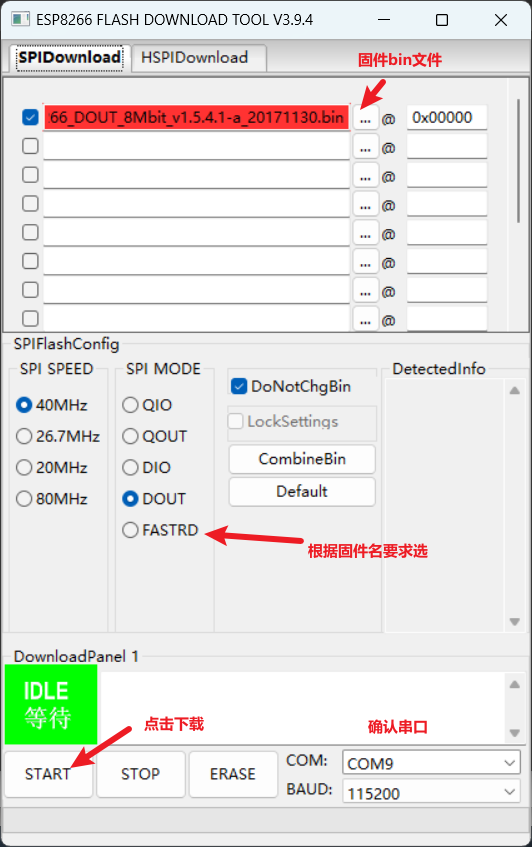
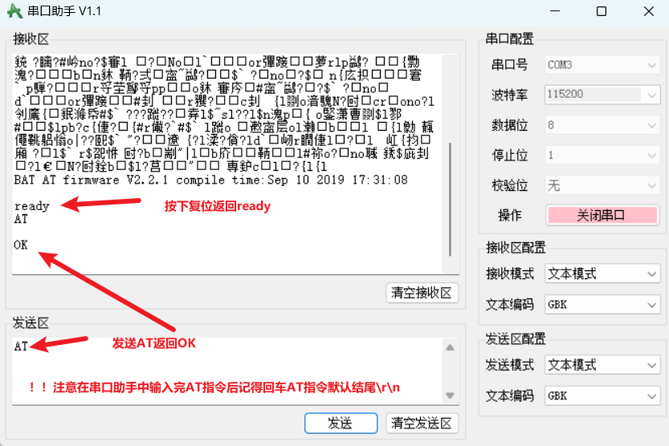

## ESP8266固件库烧录

### 第一步

打开[https://docs.ai-thinker.com/%E5%9B%BA%E4%BB%B6%E6%B1%87%E6%80%BB](https://docs.ai-thinker.com/%E5%9B%BA%E4%BB%B6%E6%B1%87%E6%80%BB)网页下载固件库

### 第二步

打开烧录工具

通过网盘分享的文件：ESP8266固件烧录.7z  
链接: https://pan.baidu.com/s/1g8zgB5y9j4uFmXhZp-tIww?pwd=1145 提取码: 1145  
\--来自百度网盘超级会员v5的分享

### 第三步

烧录

### 第四步

打开串口工具检测是否烧录成功

## AT指令库

[https://docs.espressif.com/projects/esp-at/zh\_CN/latest/esp32/AT\_Command\_Set/Basic\_AT\_Commands.html](https://docs.espressif.com/projects/esp-at/zh_CN/latest/esp32/AT_Command_Set/Basic_AT_Commands.html)

## ESP8266WiFi库

### WiFi

- mode
    - `WIFI_OFF`：关闭 WiFi。
    
    - `WIFI_STA`：切换到 [Station（STA）](https://arduino-esp8266.readthedocs.io/en/latest/esp8266wifi/readme.html#station) 模式 。
    
    - `WIFI_AP`：切换[到 AP](https://arduino-esp8266.readthedocs.io/en/latest/esp8266wifi/readme.html#soft-access-point) 模式 。
    
    - `WIFI_AP_STA`：启用站（STA）和接入点（AP） 模式 。

- **softAP(作为接入点)**
    - \- ssid: char型，WiFi网络名称
    
    - – passphrase: int型，WiFi密码(对于WPA2加密类型最少8个字符，对于开放网络设置为NULL)
    
    - – channel: int型，wifi信道。可选通道有1-13，不设置的情况下默认是1。
    
    - – hidden: bool型，控制 WiFI是否隐藏的标志变量。设置为0不隐藏，设置为1隐藏。
    
    - – max\_connection: int型，最大的允许连接的无线终端数量。可选数值范围是1 – 4(ESP8266模块最多允许同时连接的无线终端设备数量是4个）

- `softAPConfig`
    - local\_ip： 接入点的ip地址。(IPAddress型)
    
    - gateway： 网关IP地址。 (IPAddress型)
    
    - subnet： 子网掩码。(IPAddress型）

- softAPdisconnect
    - 参数val类型为bool。如果将该参数设置为true，设备将直接关闭接入点模式。

- — [softAPIP](http://www.taichi-maker.com/?page_id=8607&preview=true) – 获取接入点IP地址

- — [softAPmacAddress](http://www.taichi-maker.com/homepage/iot-development/iot-dev-reference/esp8266-c-plus-plus-reference/esp8266wifiap/softapmacaddress/) – 获取接入点mac

- — [softAPSSID](http://www.taichi-maker.com/homepage/iot-development/iot-dev-reference/esp8266-c-plus-plus-reference/esp8266wifiap/softapssid/) – 获取接入点WiFi名称

- — [softAPPSK](http://www.taichi-maker.com/homepage/iot-development/iot-dev-reference/esp8266-c-plus-plus-reference/esp8266wifiap/softappsk/) – 获取接入点连接密码

- — [softAPGetStationNum](http://www.taichi-maker.com/homepage/iot-development/iot-dev-reference/esp8266-c-plus-plus-reference/esp8266wifiap/softapgetstationnum/) – 获取连接上的终端数量

- **`begin`(作为站)**
    - ssid – 要连接的wifi接入点的名字，最多可以包含32个字符。(类型：char\*)
    
    - password – 要连接的 wifi接入点密码，长度至少应为8个字符且不超过64个字符。(类型：char\*)
    
    - channel – 要连接的wifi接入点信道。(类型：int32\_t)
    
    - bssid – 要连接的wifi接入点的mac地址。(类型：const uint8\_t\*)
    
    - connect – 连接状态参数。如果connect参数为true，ESP8266开发板会使用闪存中储存的信息尝试连接WiFi。如果connect参数为false，ESP8266开发板不会尝试连接WiFi，而只会将WiFi连接信息保存在闪存中。(类型：bool)

- `config`
    - local\_ip: 配置ESP8266的固定IP地址。(IPAdress型)
    
    - gateway: 网关IP地址。(IPAdress型)
    
    - subnet: 子网掩码。(IPAddress型)
    
    - dns1，dns2: 这两个参数是可选参数。它们可定义域名服务器（DNS）的ip地址，这些域名服务器会关联一个域名目录，并将它们翻译成ip地址 (IPAddress型)

- `reconnec`t(重新连接WiFi)

- – [disconnect](http://www.taichi-maker.com/homepage/iot-development/iot-dev-reference/esp8266-c-plus-plus-reference/esp8266wifista/disconnect/) – 断开WiFi连接

- – [setAutoConnect](http://www.taichi-maker.com/homepage/iot-development/iot-dev-reference/esp8266-c-plus-plus-reference/esp8266wifista/setautoconnect/) – 设置是否自动连接WiFi

- – [setAutoReconnect](http://www.taichi-maker.com/homepage/iot-development/iot-dev-reference/esp8266-c-plus-plus-reference/esp8266wifista/setautoreconnect/) – 设置是否自动重新连接WiFi

- – [waitForConnectResult](http://www.taichi-maker.com/homepage/iot-development/iot-dev-reference/esp8266-c-plus-plus-reference/esp8266wifista/waitforconnectresult/) – 等待WiFi连接

- – [status](http://www.taichi-maker.com/homepage/iot-development/iot-dev-reference/esp8266-c-plus-plus-reference/esp8266wifista/status/) – 获取WiFi连接状态

- – [SSID](http://www.taichi-maker.com/homepage/iot-development/iot-dev-reference/esp8266-c-plus-plus-reference/esp8266wifista/ssid/) – 获取SSID

- – [psk](http://www.taichi-maker.com/homepage/iot-development/iot-dev-reference/esp8266-c-plus-plus-reference/esp8266wifista/psk/) – 获取psk

- – [BSSIDstr](http://www.taichi-maker.com/homepage/iot-development/iot-dev-reference/esp8266-c-plus-plus-reference/esp8266wifista/bssidstr/) – 获取WiFi接入点的mac地址

- – [localIP](http://www.taichi-maker.com/homepage/iot-development/iot-dev-reference/esp8266-c-plus-plus-reference/esp8266wifista/localip/) – 获取IP地址

- – [subnetMask](http://www.taichi-maker.com/homepage/iot-development/iot-dev-reference/esp8266-c-plus-plus-reference/esp8266wifista/subnetmask/) – 获取子网掩码

- – [gatewayIP](http://www.taichi-maker.com/homepage/iot-development/iot-dev-reference/esp8266-c-plus-plus-reference/esp8266wifista/gatewayip/) – 获取网关地址

- – [dnsIP](http://www.taichi-maker.com/homepage/iot-development/iot-dev-reference/esp8266-c-plus-plus-reference/esp8266wifista/dnsip/) – 获取DNS地址

- – [macAddress](http://www.taichi-maker.com/homepage/iot-development/iot-dev-reference/esp8266-c-plus-plus-reference/esp8266wifista/macaddress/) – 获取mac地址

- – [hostname](http://www.taichi-maker.com/homepage/iot-development/iot-dev-reference/esp8266-c-plus-plus-reference/esp8266wifista/hostname/) – 获取/设置主机名

- – [isConnected](http://www.taichi-maker.com/homepage/iot-development/iot-dev-reference/esp8266-c-plus-plus-reference/esp8266wifista/isconnected/) – 获取WiFi连接状态

- – [getAutoConnect](http://www.taichi-maker.com/homepage/iot-development/iot-dev-reference/esp8266-c-plus-plus-reference/esp8266wifista/getautoconnect/) – 获取自动连接WiFi设置

- – [RSSI](http://www.taichi-maker.com/homepage/iot-development/iot-dev-reference/esp8266-c-plus-plus-reference/esp8266wifista/rssi/) – 获取WiFi信号强度

## ESP8266WiFiGeneric库

接入点模式事件类型  
— [onSoftAPModeStationConnected](http://www.taichi-maker.com/homepage/iot-development/iot-dev-reference/esp8266-c-plus-plus-reference/esp8266wifigeneric/onsoftapmodestationconnected/) – 有无线终端连接到接入点  
— [onSoftAPModeStationDisconnected](http://www.taichi-maker.com/homepage/iot-development/iot-dev-reference/esp8266-c-plus-plus-reference/esp8266wifigeneric/onsoftapmodestationdisconnected/) – 有无线终端断开与接入点的连接  
— [onSoftAPModeProbeRequestReceived](http://www.taichi-maker.com/homepage/iot-development/iot-dev-reference/esp8266-c-plus-plus-reference/esp8266wifigeneric/onsoftapmodeproberequestreceived/) – 接入点模式下收到探针请求

无线终端模式事件类型  
— [onStationModeConnected](http://www.taichi-maker.com/homepage/iot-development/iot-dev-reference/esp8266-c-plus-plus-reference/esp8266wifigeneric/8260-2/) – 无线终端模式连上WiFi  
— [onStationModeDisconnected](http://www.taichi-maker.com/homepage/iot-development/iot-dev-reference/esp8266-c-plus-plus-reference/esp8266wifigeneric/onstationmodedisconnected/) – 无线终端模式断开WiFi  
— [onStationModeAuthModeChanged](http://www.taichi-maker.com/homepage/iot-development/iot-dev-reference/esp8266-c-plus-plus-reference/esp8266wifigeneric/onstationmodeauthmodechanged/) – 无线终端模式下校验模式改变  
— [onStationModeGotIP](http://www.taichi-maker.com/homepage/iot-development/iot-dev-reference/esp8266-c-plus-plus-reference/esp8266wifigeneric/onstationmodegotip/) – 无线终端模式下获取到IP地址  
— [onStationModeDHCPTimeout](http://www.taichi-maker.com/homepage/iot-development/iot-dev-reference/esp8266-c-plus-plus-reference/esp8266wifigeneric/onstationmodedhcptimeout/) – 无线终端模式下动态分配IP超时

设置类型  
— [persistent](http://www.taichi-maker.com/homepage/iot-development/iot-dev-reference/esp8266-c-plus-plus-reference/esp8266wifigeneric/persistent/) – 是否保存WiFi连接信息在闪存中  
— [mode](http://www.taichi-maker.com/homepage/iot-development/iot-dev-reference/esp8266-c-plus-plus-reference/esp8266wifigeneric/8286-2/) – 设置WiFi工作模式  
— [enableSTA](http://www.taichi-maker.com/homepage/iot-development/iot-dev-reference/esp8266-c-plus-plus-reference/esp8266wifigeneric/enablesta/) – 设置为终端模式  
— [enableAP](http://www.taichi-maker.com/homepage/iot-development/iot-dev-reference/esp8266-c-plus-plus-reference/esp8266wifigeneric/enableap/) – 设置为接入点模式  
— [setSleepMode](http://www.taichi-maker.com/homepage/iot-development/iot-dev-reference/esp8266-c-plus-plus-reference/esp8266wifigeneric/setsleepmode/) – 设置为休眠模式

信息类型  
— [getMode](http://www.taichi-maker.com/homepage/iot-development/iot-dev-reference/esp8266-c-plus-plus-reference/esp8266wifigeneric/getmode/) – 获取WiFi工作模式

## ESP8266WiFiMulti

设置类型  
– [addAp](http://www.taichi-maker.com/homepage/iot-development/iot-dev-reference/esp8266-c-plus-plus-reference/esp8266wifimulti/addap/) – 添加 WiFi连接信息  
– [run](http://www.taichi-maker.com/homepage/iot-development/iot-dev-reference/esp8266-c-plus-plus-reference/esp8266wifimulti/run/) – 连接WiFi  
– [cleanAPlist](http://www.taichi-maker.com/homepage/iot-development/iot-dev-reference/esp8266-c-plus-plus-reference/esp8266wifimulti/cleanaplist/) – 清除WiFi连接信息

信息类型  
– [existsAP](http://www.taichi-maker.com/homepage/iot-development/iot-dev-reference/esp8266-c-plus-plus-reference/esp8266wifimulti/existsap/) – 检查WiFi连接信息内容

## SP8266WiFiScan

设置类型  
– [scanNetworks](http://www.taichi-maker.com/homepage/iot-development/iot-dev-reference/esp8266-c-plus-plus-reference/esp8266wifiscan/scannetworks/) – 同步扫描WiFi网络  
– [scanNetworksAsync](http://www.taichi-maker.com/homepage/iot-development/iot-dev-reference/esp8266-c-plus-plus-reference/esp8266wifiscan/scannetworksasync/) – 异步扫描WiFi网络  
– [scanDelete](http://www.taichi-maker.com/homepage/iot-development/iot-dev-reference/esp8266-c-plus-plus-reference/esp8266wifiscan/scandelete/) – 删除扫描结果

信息类型  
– [getNetworkInfo](http://www.taichi-maker.com/homepage/iot-development/iot-dev-reference/esp8266-c-plus-plus-reference/esp8266wifiscan/getnetworkinfo/) – 获取扫描到的WiFi网络信息(网络名称，信号强度等）  
– [SSID](http://www.taichi-maker.com/homepage/iot-development/iot-dev-reference/esp8266-c-plus-plus-reference/esp8266wifiscan/ssid/) – 获取扫描到的WiFi网络名称  
– [RSSI](http://www.taichi-maker.com/homepage/iot-development/iot-dev-reference/esp8266-c-plus-plus-reference/esp8266wifiscan/8747-2/) – 获取扫描到的WiFi网络信号强度  
– [encryptionType](http://www.taichi-maker.com/homepage/iot-development/iot-dev-reference/esp8266-c-plus-plus-reference/esp8266wifiscan/encryptiontype/) – 获取扫描到的WiFi网络加密类型  
– [BSSID / BSSIDstr](http://www.taichi-maker.com/homepage/iot-development/iot-dev-reference/esp8266-c-plus-plus-reference/esp8266wifiscan/bssid/) – 获取扫描到的WiFi网络mac地址  
– [channel](http://www.taichi-maker.com/homepage/iot-development/iot-dev-reference/esp8266-c-plus-plus-reference/esp8266wifiscan/channel/) – 获取扫描到的WiFi网络信道号  
– [isHidden](http://www.taichi-maker.com/homepage/iot-development/iot-dev-reference/esp8266-c-plus-plus-reference/esp8266wifiscan/ishidden/) – 检查扫描到的WiFi网络是否是隐藏网络  
– [scanComplete](http://www.taichi-maker.com/homepage/iot-development/iot-dev-reference/esp8266-c-plus-plus-reference/esp8266wifiscan/scancomplete/) – 获取异步扫描结果或状态

## WiFiClient（TCP）

连接服务器类型  
设置类型  
— [connect – 连接服务器](http://www.taichi-maker.com/homepage/iot-development/iot-dev-reference/esp8266-c-plus-plus-reference/wificlient/connect/)  
— [stop – 停止客户端](http://www.taichi-maker.com/homepage/iot-development/iot-dev-reference/esp8266-c-plus-plus-reference/wificlient/stop/)  
— [setNoDelay- 停止小包合并发送](http://www.taichi-maker.com/homepage/iot-development/iot-dev-reference/esp8266-c-plus-plus-reference/wificlient/setnodelay/)

信息类型  
— [connected – 检查是否成功连接服务器](http://www.taichi-maker.com/homepage/iot-development/iot-dev-reference/esp8266-c-plus-plus-reference/wificlient/connected/)  
— [status – 获取客户端运行状态](http://www.taichi-maker.com/homepage/iot-development/iot-dev-reference/esp8266-c-plus-plus-reference/wificlient/status/)

发送数据类型  
— [print – 发送信息](http://www.taichi-maker.com/homepage/iot-development/iot-dev-reference/esp8266-c-plus-plus-reference/wificlient/print/)（[Stream类](http://www.taichi-maker.com/homepage/reference-index/arduino-code-reference/stream/)）  
— [println – 发送信息](http://www.taichi-maker.com/homepage/iot-development/iot-dev-reference/esp8266-c-plus-plus-reference/wificlient/println/)（[Stream类](http://www.taichi-maker.com/homepage/reference-index/arduino-code-reference/stream/)）  
— [write – 发送信息](http://www.taichi-maker.com/homepage/iot-development/iot-dev-reference/esp8266-c-plus-plus-reference/wificlient/write/)（[Stream类](http://www.taichi-maker.com/homepage/reference-index/arduino-code-reference/stream/)）  
— [Stream类](http://www.taichi-maker.com/homepage/reference-index/arduino-code-reference/stream/)

响应信息操作类型  
— [readString – 读取数据并保存为字符串](http://www.taichi-maker.com/homepage/iot-development/iot-dev-reference/esp8266-c-plus-plus-reference/wificlient/readString/) （[Stream类](http://www.taichi-maker.com/homepage/reference-index/arduino-code-reference/stream/)）  
— [readStringUntil – 读取数据直到指定字符并保存为字符串](http://www.taichi-maker.com/homepage/iot-development/iot-dev-reference/esp8266-c-plus-plus-reference/wificlient/readStringuntil/) （[Stream类](http://www.taichi-maker.com/homepage/reference-index/arduino-code-reference/stream/)）  
— [find – 在数据中寻找信息](http://www.taichi-maker.com/homepage/iot-development/iot-dev-reference/esp8266-c-plus-plus-reference/wificlient/find/)（[Stream类](http://www.taichi-maker.com/homepage/reference-index/arduino-code-reference/stream/)）  
— [parseInt – 解析数据中的整数](http://www.taichi-maker.com/homepage/iot-development/iot-dev-reference/esp8266-c-plus-plus-reference/wificlient/parseint/)（[Stream类](http://www.taichi-maker.com/homepage/reference-index/arduino-code-reference/stream/)）  
— [Stream类](http://www.taichi-maker.com/homepage/reference-index/arduino-code-reference/stream/)  
**备注:以上带有（[Stream类](http://www.taichi-maker.com/homepage/reference-index/arduino-code-reference/stream/)）标注的函数说明该函数是Stream类函数。**

## WiFiServer（TCP）

服务器设置类型  
— [WiFiServer](http://www.taichi-maker.com/homepage/iot-development/iot-dev-reference/esp8266-c-plus-plus-reference/wifiserver/wifiserver/) – 建立新的WiFiServer对象  
— [begin](http://www.taichi-maker.com/homepage/iot-development/iot-dev-reference/esp8266-c-plus-plus-reference/wifiserver/begin/) – 服务器启动  
— [setNoDelay](http://www.taichi-maker.com/homepage/iot-development/iot-dev-reference/esp8266-c-plus-plus-reference/wifiserver/setnodelay/) – 停止小包合并发送  
— [stop](http://www.taichi-maker.com/homepage/iot-development/iot-dev-reference/esp8266-c-plus-plus-reference/wifiserver/stop/) – 停止服务器  
— [close](http://www.taichi-maker.com/homepage/iot-development/iot-dev-reference/esp8266-c-plus-plus-reference/wifiserver/close/) – 停止服务器

服务器信息类型  
— [status](http://www.taichi-maker.com/homepage/iot-development/iot-dev-reference/esp8266-c-plus-plus-reference/wifiserver/status/) – 获取服务器运行状态  
— [hasClient](http://www.taichi-maker.com/homepage/iot-development/iot-dev-reference/esp8266-c-plus-plus-reference/wifiserver/hasclient/) – 判断是否有客户端访问

响应信息操作类型  
— [Stream类](http://www.taichi-maker.com/homepage/reference-index/arduino-code-reference/stream/)

## ESP8266HTTPClient（HTTP）

请求类型  
请求信息类型  
— [begin](http://www.taichi-maker.com/homepage/iot-development/iot-dev-reference/esp8266-c-plus-plus-reference/esp8266httpclient/begin/) – 设置请求URL  
— [setReuse](http://www.taichi-maker.com/homepage/iot-development/iot-dev-reference/esp8266-c-plus-plus-reference/esp8266httpclient/setreuse/) – 设置请求头中的keep-alive  
— [setUserAgent](http://www.taichi-maker.com/homepage/iot-development/iot-dev-reference/esp8266-c-plus-plus-reference/esp8266httpclient/setuseragent/) – 设置请求头中的User-Agent  
— [setAuthorization](http://www.taichi-maker.com/homepage/iot-development/iot-dev-reference/esp8266-c-plus-plus-reference/esp8266httpclient/setauthorization/) – 设置请求头中的Authorization  
— [addHeader](http://www.taichi-maker.com/homepage/iot-development/iot-dev-reference/esp8266-c-plus-plus-reference/esp8266httpclient/addheader/) – 请求头中添加自定义信息  
— [useHTTP10](http://www.taichi-maker.com/homepage/iot-development/iot-dev-reference/esp8266-c-plus-plus-reference/esp8266httpclient/usehttp10/) – 设置http协议版本

请求方法类型  
— [GET](http://www.taichi-maker.com/homepage/iot-development/iot-dev-reference/esp8266-c-plus-plus-reference/esp8266httpclient/get/)  
— [POST](http://www.taichi-maker.com/homepage/iot-development/iot-dev-reference/esp8266-c-plus-plus-reference/esp8266httpclient/post/)  
— [PUT](http://www.taichi-maker.com/homepage/iot-development/iot-dev-reference/esp8266-c-plus-plus-reference/esp8266httpclient/put/)  
— [PATCH](http://www.taichi-maker.com/homepage/iot-development/iot-dev-reference/esp8266-c-plus-plus-reference/esp8266httpclient/patch/)

发送请求类型  
— [sendRequest](http://www.taichi-maker.com/homepage/iot-development/iot-dev-reference/esp8266-c-plus-plus-reference/esp8266httpclient/sendrequest/) – 发送请求  
— [end](http://www.taichi-maker.com/homepage/iot-development/iot-dev-reference/esp8266-c-plus-plus-reference/esp8266httpclient/end/) – 结束请求

响应类型  
响应头类型  
— [collectHeaders](http://www.taichi-maker.com/homepage/iot-development/iot-dev-reference/esp8266-c-plus-plus-reference/esp8266httpclient/collectheaders/) – 设置收集响应头内容  
— [header](http://www.taichi-maker.com/homepage/iot-development/iot-dev-reference/esp8266-c-plus-plus-reference/esp8266httpclient/header/) – 获取指定响应头参数值  
— [headers](http://www.taichi-maker.com/homepage/iot-development/iot-dev-reference/esp8266-c-plus-plus-reference/esp8266httpclient/headers/) – 获取响应头数量  
— [headerName](http://www.taichi-maker.com/homepage/iot-development/iot-dev-reference/esp8266-c-plus-plus-reference/esp8266httpclient/headername/) – 获取指定的响应头名  
— [hasHeader](http://www.taichi-maker.com/homepage/iot-development/iot-dev-reference/esp8266-c-plus-plus-reference/esp8266httpclient/hasheader/) – 确认是否存在指定响应头

响应体类型  
— [getString](http://www.taichi-maker.com/homepage/iot-development/iot-dev-reference/esp8266-c-plus-plus-reference/esp8266httpclient/getstring/) – 获取响应体数据并且以字符串形式返回  
— [getStream](http://www.taichi-maker.com/homepage/iot-development/iot-dev-reference/esp8266-c-plus-plus-reference/esp8266httpclient/getstream/) – 获取响应体数据并且以Stream形式返回  
— [writeToStream](http://www.taichi-maker.com/homepage/iot-development/iot-dev-reference/esp8266-c-plus-plus-reference/esp8266httpclient/writetostream/) – 获取响应体数据并且写入其它Stream对象  
— [getSize](http://www.taichi-maker.com/homepage/iot-development/iot-dev-reference/esp8266-c-plus-plus-reference/esp8266httpclient/getsize/) – 获取响应体数据字节数  
— [errorToString](http://www.taichi-maker.com/homepage/iot-development/iot-dev-reference/esp8266-c-plus-plus-reference/esp8266httpclient/errortostring/) – 获取错误代码并且以字符串形式返回

## ESP8266WebServer（HTTP）

服务器运行管理分类  
– [ESP8266WebServer](http://www.taichi-maker.com/homepage/iot-development/iot-dev-reference/esp8266-c-plus-plus-reference/esp8266webserver/esp8266webserver/) – 建立新的ESP8266WebServer对象  
– [begin](http://www.taichi-maker.com/homepage/iot-development/iot-dev-reference/esp8266-c-plus-plus-reference/esp8266webserver/begin/) – 服务器启动  
– [stop](http://www.taichi-maker.com/homepage/iot-development/iot-dev-reference/esp8266-c-plus-plus-reference/esp8266webserver/stop/) – 停止服务器  
– [close](http://www.taichi-maker.com/homepage/iot-development/iot-dev-reference/esp8266-c-plus-plus-reference/esp8266httpclient/close/) – 停止服务器

处理客户端HTTP请求分类  
客户端请求处理配置分类  
– [on](http://www.taichi-maker.com/homepage/iot-development/iot-dev-reference/esp8266-c-plus-plus-reference/esp8266webserver/on/) – 可找到资源处理配置  
– [onNotFound](http://www.taichi-maker.com/homepage/iot-development/iot-dev-reference/esp8266-c-plus-plus-reference/esp8266webserver/onnotfound/) – 未找到资源处理配置  
– [onFileUpload](http://www.taichi-maker.com/homepage/iot-development/iot-dev-reference/esp8266-c-plus-plus-reference/esp8266webserver/onfileupload/) – 文件上传处理配置  
– [addHandler](http://www.taichi-maker.com/homepage/iot-development/iot-dev-reference/esp8266-c-plus-plus-reference/esp8266webserver/addhandler/) – 设置请求响应回调

处理客户端请求分类  
– [handleClient](http://www.taichi-maker.com/homepage/iot-development/iot-dev-reference/esp8266-c-plus-plus-reference/esp8266webserver/handleclient/) – 处理客户端请求

获取客户端请求信息分类  
获取客户端请求行信息分类  
– [uri](http://www.taichi-maker.com/homepage/iot-development/iot-dev-reference/esp8266-c-plus-plus-reference/esp8266webserver/uri/) – 获取请求路径  
– [method](http://www.taichi-maker.com/homepage/iot-development/iot-dev-reference/esp8266-c-plus-plus-reference/esp8266webserver/method/) – 获取请求方法

获取客户端请求头信息分类  
– [collectHeaders](http://www.taichi-maker.com/homepage/iot-development/iot-dev-reference/esp8266-c-plus-plus-reference/esp8266webserver/collectheaders/) – 设置需要收集哪些请求头信息  
– [headers](http://www.taichi-maker.com/homepage/iot-development/iot-dev-reference/esp8266-c-plus-plus-reference/esp8266webserver/headers/) – 获得请求头数量  
– [header](http://www.taichi-maker.com/homepage/iot-development/iot-dev-reference/esp8266-c-plus-plus-reference/esp8266webserver/header/) – 获得指定请求头所对应的数值  
– [headerName](http://www.taichi-maker.com/homepage/iot-development/iot-dev-reference/esp8266-c-plus-plus-reference/esp8266webserver/headername/) – 获取指定请求头的名称  
– [hasHeader](http://www.taichi-maker.com/homepage/iot-development/iot-dev-reference/esp8266-c-plus-plus-reference/esp8266webserver/hasheader/) – 确定是否包含指定请求头  
– [authenticate](http://www.taichi-maker.com/homepage/iot-development/iot-dev-reference/esp8266-c-plus-plus-reference/esp8266webserver/authenticate/) – 请求认证校验

获取客户端请求参数信息分类  
– [args](http://www.taichi-maker.com/homepage/iot-development/iot-dev-reference/esp8266-c-plus-plus-reference/esp8266webserver/args/) – 请求包含的参数数量  
– [arg](http://www.taichi-maker.com/homepage/iot-development/iot-dev-reference/esp8266-c-plus-plus-reference/esp8266webserver/arg/) – 请求中指定参数的数值  
– [argName](http://www.taichi-maker.com/homepage/iot-development/iot-dev-reference/esp8266-c-plus-plus-reference/esp8266webserver/argname/) – 请求中参数名  
– [hasArg](http://www.taichi-maker.com/homepage/iot-development/iot-dev-reference/esp8266-c-plus-plus-reference/esp8266webserver/hasarg/) – 判断请求中是否包含某个参数名

响应客户端请求分类  
– [send](http://www.taichi-maker.com/homepage/iot-development/iot-dev-reference/esp8266-c-plus-plus-reference/esp8266webserver/send/) – 发送响应信息

- contentType内容类型

- 一、文本类型  
    ​**​text/html​**​ 用途：用于HTML网页文件（如`.html`、`.htm`文件）  
    。  
    ​**​text/plain​**​ 用途：纯文本格式，适用于简单文本信息或无格式数据  
    。  
    ​**​text/css​**​ 用途：CSS样式表文件（如`.css`文件）  
    。  
    ​**​text/xml​**​ 用途：XML格式数据  
    。  
      
    二、图像类型  
    ​**​image/png​**​ 用途：PNG图像文件  
    。  
    ​**​image/jpeg​**​（或​**​image/jpg​**​） 用途：JPEG图像文件  
    。  
    ​**​image/gif​**​ 用途：GIF动图或静态图  
    。  
    ​**​image/x-icon​**​ 用途：网站图标（如`.ico`文件）  
    。  
      
    三、应用程序类型  
    ​**​application/json​**​ 用途：JSON数据格式，适用于API接口返回结构化数据  
    。  
    ​**​application/javascript​**​ 用途：JavaScript脚本文件（如`.js`文件）  
    。  
    ​**​application/x-pdf​**​ 用途：PDF文件  
    。  
    ​**​application/x-zip​**​ 用途：ZIP压缩文件  
    。  
    ​**​application/x-gzip​**​ 用途：GZIP压缩文件  
    。  
      
    四、其他类型  
    ​**​multipart/form-data​**​ 用途：文件上传或包含二进制数据的表单提交（需结合特定处理逻辑）  
    。  
    ​**​application/octet-stream​**​ 用途：通用二进制流，常用于文件下载。

  
– [sendHeader](http://www.taichi-maker.com/homepage/iot-development/iot-dev-reference/esp8266-c-plus-plus-reference/esp8266webserver/sendheader/) – 发送响应头  
– [sendContent](http://www.taichi-maker.com/homepage/iot-development/iot-dev-reference/esp8266-c-plus-plus-reference/esp8266webserver/sendcontent/) – 发送响应体信息  
– [sendContent\_P](http://www.taichi-maker.com/homepage/iot-development/iot-dev-reference/esp8266-c-plus-plus-reference/esp8266webserver/sendcontent_p/) – 发送响应体信息  
– [streamFile](http://www.taichi-maker.com/homepage/iot-development/iot-dev-reference/esp8266-c-plus-plus-reference/esp8266webserver/streamfile/) – 发送响应体信息  
– [setContentLength](http://www.taichi-maker.com/homepage/iot-development/iot-dev-reference/esp8266-c-plus-plus-reference/esp8266webserver/setContentLength/) – 设置响应体长度  
– [upload](http://www.taichi-maker.com/homepage/iot-development/iot-dev-reference/esp8266-c-plus-plus-reference/esp8266webserver/upload/) – 处理文件上传  
– [requestAuthentication](http://www.taichi-maker.com/homepage/iot-development/iot-dev-reference/esp8266-c-plus-plus-reference/esp8266webserver/requestauthentication/) – 请求客户端认证

## WiFiClientSecure（https）

连接认证类型  
连接类型  
– [WiFiClientSecure](http://www.taichi-maker.com/homepage/iot-development/iot-dev-reference/esp8266-c-plus-plus-reference/http-client-secure/wificlientsecure/) – 建立WiFiClientSecure对象  
– [connect](http://www.taichi-maker.com/homepage/iot-development/iot-dev-reference/esp8266-c-plus-plus-reference/http-client-secure/connect/) – 连接服务器  
– [stop](http://www.taichi-maker.com/homepage/iot-development/iot-dev-reference/esp8266-c-plus-plus-reference/http-client-secure/stop/) – 停止客户端  
认证类型  
– [setFingerprint](http://www.taichi-maker.com/homepage/iot-development/iot-dev-reference/esp8266-c-plus-plus-reference/http-client-secure/setfingerprint/) – 设置校验指纹  
– [setTrustAnchors](http://www.taichi-maker.com/homepage/iot-development/iot-dev-reference/esp8266-c-plus-plus-reference/http-client-secure/settrustanchors/) – 设置信任锚  
– [setX509Time](http://www.taichi-maker.com/homepage/iot-development/iot-dev-reference/esp8266-c-plus-plus-reference/http-client-secure/setx509time/) – 设置时间以认证x.509数字证书  
– [setInsecure](http://www.taichi-maker.com/homepage/iot-development/iot-dev-reference/esp8266-c-plus-plus-reference/http-client-secure/setinsecure/) – 设置不进行身份校验  
– [allowSelfSignedCerts](http://www.taichi-maker.com/homepage/iot-development/iot-dev-reference/esp8266-c-plus-plus-reference/http-client-secure/allowselfsigned/) – 允许自签名证书  
– [setKnownKey](http://www.taichi-maker.com/homepage/iot-development/iot-dev-reference/esp8266-c-plus-plus-reference/http-client-secure/setknownkey/) – 设置服务器公钥  
– [setCiphers](http://www.taichi-maker.com/homepage/iot-development/iot-dev-reference/esp8266-c-plus-plus-reference/http-client-secure/setciphers/) – 设置加密方式(自定义)  
– [setCiphersLessSecure](http://www.taichi-maker.com/homepage/iot-development/iot-dev-reference/esp8266-c-plus-plus-reference/http-client-secure/setcipherslesssecure/)– 设置加密方式(低级别)  
– [setClientRSACert](http://www.taichi-maker.com/homepage/iot-development/iot-dev-reference/esp8266-c-plus-plus-reference/http-client-secure/setclientrsacert/) – 设置客户端RSA证书  
– [setSession](http://www.taichi-maker.com/homepage/iot-development/iot-dev-reference/esp8266-c-plus-plus-reference/http-client-secure/setsession/) – 会话控制  
– [setBufferSizes](http://www.taichi-maker.com/homepage/iot-development/iot-dev-reference/esp8266-c-plus-plus-reference/http-client-secure/setBufferSizes/) – 设置缓存大小  
– [setCertStore](http://www.taichi-maker.com/homepage/iot-development/iot-dev-reference/esp8266-c-plus-plus-reference/http-client-secure/setcertstore/) – 设置证书储存  
状态信息类型  
– [connected](http://www.taichi-maker.com/homepage/iot-development/iot-dev-reference/esp8266-c-plus-plus-reference/http-client-secure/connected/) – 检查是否成功连接服务器  
– [getLastSSLError](http://www.taichi-maker.com/homepage/iot-development/iot-dev-reference/esp8266-c-plus-plus-reference/http-client-secure/getlastsslerror/) – 获取SSL错误信息

发送数据类型  
– [print](http://www.taichi-maker.com/homepage/iot-development/iot-dev-reference/esp8266-c-plus-plus-reference/http-client-secure/print/) – 发送信息（[Stream类](http://www.taichi-maker.com/homepage/reference-index/arduino-code-reference/stream/)）  
– [println](http://www.taichi-maker.com/homepage/iot-development/iot-dev-reference/esp8266-c-plus-plus-reference/http-client-secure/println/) – 发送信息（[Stream类](http://www.taichi-maker.com/homepage/reference-index/arduino-code-reference/stream/)）  
– [write](http://www.taichi-maker.com/homepage/iot-development/iot-dev-reference/esp8266-c-plus-plus-reference/http-client-secure/write/) – 发送信息（[Stream类](http://www.taichi-maker.com/homepage/reference-index/arduino-code-reference/stream/)）  
– [Stream类](http://www.taichi-maker.com/homepage/reference-index/arduino-code-reference/stream/)

响应信息类型  
– [readString](http://www.taichi-maker.com/homepage/iot-development/iot-dev-reference/esp8266-c-plus-plus-reference/http-client-secure/readstring/) – 读取数据并保存为字符串（[Stream类](http://www.taichi-maker.com/homepage/reference-index/arduino-code-reference/stream/)）  
– [readStringUntil](http://www.taichi-maker.com/homepage/iot-development/iot-dev-reference/esp8266-c-plus-plus-reference/http-client-secure/readstringuntil/) – 读取数据直到指定字符并保存为字符串（[Stream类](http://www.taichi-maker.com/homepage/reference-index/arduino-code-reference/stream/)）  
– [find](http://www.taichi-maker.com/homepage/iot-development/iot-dev-reference/esp8266-c-plus-plus-reference/http-client-secure/find/) – 在数据中寻找信息（[Stream类](http://www.taichi-maker.com/homepage/reference-index/arduino-code-reference/stream/)）  
– [parseInt](http://www.taichi-maker.com/homepage/iot-development/iot-dev-reference/esp8266-c-plus-plus-reference/http-client-secure/parseint/) – 解析数据中的整数（[Stream类](http://www.taichi-maker.com/homepage/reference-index/arduino-code-reference/stream/)）  
– [Stream类](http://www.taichi-maker.com/homepage/reference-index/arduino-code-reference/stream/)

## ESP8266WebServer（https）

服务器运行管理分类  
– [ESP8266WebServer](http://www.taichi-maker.com/homepage/iot-development/iot-dev-reference/esp8266-c-plus-plus-reference/esp8266webserver/esp8266webserver/) – 建立新的ESP8266WebServer对象  
– [begin](http://www.taichi-maker.com/homepage/iot-development/iot-dev-reference/esp8266-c-plus-plus-reference/esp8266webserver/begin/) – 服务器启动  
– [stop](http://www.taichi-maker.com/homepage/iot-development/iot-dev-reference/esp8266-c-plus-plus-reference/esp8266webserver/stop/) – 停止服务器  
– [close](http://www.taichi-maker.com/homepage/iot-development/iot-dev-reference/esp8266-c-plus-plus-reference/esp8266httpclient/close/) – 停止服务器

处理客户端HTTP请求分类  
客户端请求处理配置分类  
– [on](http://www.taichi-maker.com/homepage/iot-development/iot-dev-reference/esp8266-c-plus-plus-reference/esp8266webserver/on/) – 可找到资源处理配置  
– [onNotFound](http://www.taichi-maker.com/homepage/iot-development/iot-dev-reference/esp8266-c-plus-plus-reference/esp8266webserver/onnotfound/) – 未找到资源处理配置  
– [onFileUpload](http://www.taichi-maker.com/homepage/iot-development/iot-dev-reference/esp8266-c-plus-plus-reference/esp8266webserver/onfileupload/) – 文件上传处理配置  
– [addHandler](http://www.taichi-maker.com/homepage/iot-development/iot-dev-reference/esp8266-c-plus-plus-reference/esp8266webserver/addhandler/) – 设置请求响应回调

处理客户端请求分类  
– [handleClient](http://www.taichi-maker.com/homepage/iot-development/iot-dev-reference/esp8266-c-plus-plus-reference/esp8266webserver/handleclient/) – 处理客户端请求

获取客户端请求信息分类  
获取客户端请求行信息分类  
– [uri](http://www.taichi-maker.com/homepage/iot-development/iot-dev-reference/esp8266-c-plus-plus-reference/esp8266webserver/uri/) – 获取请求路径  
– [method](http://www.taichi-maker.com/homepage/iot-development/iot-dev-reference/esp8266-c-plus-plus-reference/esp8266webserver/method/) – 获取请求方法

获取客户端请求头信息分类  
– [collectHeaders](http://www.taichi-maker.com/homepage/iot-development/iot-dev-reference/esp8266-c-plus-plus-reference/esp8266webserver/collectheaders/) – 设置需要收集哪些请求头信息  
– [headers](http://www.taichi-maker.com/homepage/iot-development/iot-dev-reference/esp8266-c-plus-plus-reference/esp8266webserver/headers/) – 获得请求头数量  
– [header](http://www.taichi-maker.com/homepage/iot-development/iot-dev-reference/esp8266-c-plus-plus-reference/esp8266webserver/header/) – 获得指定请求头所对应的数值  
– [headerName](http://www.taichi-maker.com/homepage/iot-development/iot-dev-reference/esp8266-c-plus-plus-reference/esp8266webserver/headername/) – 获取指定请求头的名称  
– [hasHeader](http://www.taichi-maker.com/homepage/iot-development/iot-dev-reference/esp8266-c-plus-plus-reference/esp8266webserver/hasheader/) – 确定是否包含指定请求头  
– [authenticate](http://www.taichi-maker.com/homepage/iot-development/iot-dev-reference/esp8266-c-plus-plus-reference/esp8266webserver/authenticate/) – 请求认证校验

获取客户端请求参数信息分类  
– [args](http://www.taichi-maker.com/homepage/iot-development/iot-dev-reference/esp8266-c-plus-plus-reference/esp8266webserver/args/) – 请求包含的参数数量  
– [arg](http://www.taichi-maker.com/homepage/iot-development/iot-dev-reference/esp8266-c-plus-plus-reference/esp8266webserver/arg/) – 请求中指定参数的数值  
– [argName](http://www.taichi-maker.com/homepage/iot-development/iot-dev-reference/esp8266-c-plus-plus-reference/esp8266webserver/argname/) – 请求中参数名  
– [hasArg](http://www.taichi-maker.com/homepage/iot-development/iot-dev-reference/esp8266-c-plus-plus-reference/esp8266webserver/hasarg/) – 判断请求中是否包含某个参数名

响应客户端请求分类  
– [send](http://www.taichi-maker.com/homepage/iot-development/iot-dev-reference/esp8266-c-plus-plus-reference/esp8266webserver/send/) – 发送响应信息  
– [sendHeader](http://www.taichi-maker.com/homepage/iot-development/iot-dev-reference/esp8266-c-plus-plus-reference/esp8266webserver/sendheader/) – 发送响应头  
– [sendContent](http://www.taichi-maker.com/homepage/iot-development/iot-dev-reference/esp8266-c-plus-plus-reference/esp8266webserver/sendcontent/) – 发送响应体信息  
– [sendContent\_P](http://www.taichi-maker.com/homepage/iot-development/iot-dev-reference/esp8266-c-plus-plus-reference/esp8266webserver/sendcontent_p/) – 发送响应体信息  
– [streamFile](http://www.taichi-maker.com/homepage/iot-development/iot-dev-reference/esp8266-c-plus-plus-reference/esp8266webserver/streamfile/) – 发送响应体信息  
– [setContentLength](http://www.taichi-maker.com/homepage/iot-development/iot-dev-reference/esp8266-c-plus-plus-reference/esp8266webserver/setContentLength/) – 设置响应体长度  
– [upload](http://www.taichi-maker.com/homepage/iot-development/iot-dev-reference/esp8266-c-plus-plus-reference/esp8266webserver/upload/) – 处理文件上传  
– [requestAuthentication](http://www.taichi-maker.com/homepage/iot-development/iot-dev-reference/esp8266-c-plus-plus-reference/esp8266webserver/requestauthentication/) – 请求客户端认证

## WiFiUDP

UDP服务控制类型  
– [begin](http://www.taichi-maker.com/homepage/iot-development/iot-dev-reference/esp8266-c-plus-plus-reference/wifiudp/begin/) – 启动UDP服务  
– [stop](http://www.taichi-maker.com/homepage/iot-development/iot-dev-reference/esp8266-c-plus-plus-reference/wifiudp/stop/) – 停止UDP服务

接收/处理UDP数据类型  
– [parsePacket](http://www.taichi-maker.com/homepage/iot-development/iot-dev-reference/esp8266-c-plus-plus-reference/wifiudp/parsepacket/) – 解析数据  
– [available](http://www.taichi-maker.com/homepage/iot-development/iot-dev-reference/esp8266-c-plus-plus-reference/wifiudp/available/)(Stream类) – 检查是否有数据被接收  
– [read](http://www.taichi-maker.com/homepage/iot-development/iot-dev-reference/esp8266-c-plus-plus-reference/wifiudp/read/)(Stream类) – 读取UDP数据  
– [readString](http://www.taichi-maker.com/homepage/iot-development/iot-dev-reference/esp8266-c-plus-plus-reference/wifiudp/readstring/)(Stream类) – 读取UDP字符串  
– [parseInt](http://www.taichi-maker.com/homepage/iot-development/iot-dev-reference/esp8266-c-plus-plus-reference/wifiudp/parseint/)(Stream类) – 解析UDP数据中整数  
– [find](http://www.taichi-maker.com/homepage/iot-development/iot-dev-reference/esp8266-c-plus-plus-reference/wifiudp/find/)(Stream类) – 在UDP数据中查找信息  
– [Stream类](http://www.taichi-maker.com/homepage/reference-index/arduino-code-reference/stream/) – 以上带有(Stream类)标注的函数属于Stream类函数。

发送UDP数据类型  
– [beginPacket](http://www.taichi-maker.com/homepage/iot-development/iot-dev-reference/esp8266-c-plus-plus-reference/wifiudp/beginpacket/) – 配置UDP数据包接收设备的IP和端口  
– [endPacket](http://www.taichi-maker.com/homepage/iot-development/iot-dev-reference/esp8266-c-plus-plus-reference/wifiudp/endpacket/) – 发送UDP数据包  
– [write](http://www.taichi-maker.com/homepage/iot-development/iot-dev-reference/esp8266-c-plus-plus-reference/wifiudp/write/) – 向UDP数据包写入信息  
– [print / println](http://www.taichi-maker.com/homepage/iot-development/iot-dev-reference/esp8266-c-plus-plus-reference/wifiudp/print-println/) (Stream类) – 发送UDP数据  
– [Stream类](http://www.taichi-maker.com/homepage/reference-index/arduino-code-reference/stream/) – 以上带有(Stream类)标注的函数属于Stream类函数。

获取发送UDP数据设备信息类型  
– [remoteIP](http://www.taichi-maker.com/homepage/iot-development/iot-dev-reference/esp8266-c-plus-plus-reference/wifiudp/remoteIP/) – 获取发送UDP数据包的设备IP  
– [remotePort](http://www.taichi-maker.com/homepage/iot-development/iot-dev-reference/esp8266-c-plus-plus-reference/wifiudp/remoteport/) – 获取发送UDP数据包的设备IP

**备注:以上带有（[Stream类](http://www.taichi-maker.com/homepage/reference-index/arduino-code-reference/stream/)）标注的函数说明该函数是Stream类函数。**

## DNSServer

– [start](http://www.taichi-maker.com/homepage/iot-development/iot-dev-reference/esp8266-c-plus-plus-reference/dnsserver/start/) – 启动DNS服务  
– [stop](http://www.taichi-maker.com/homepage/iot-development/iot-dev-reference/esp8266-c-plus-plus-reference/dnsserver/stop/) – 停止DNS服务  
– [processNextRequest](http://www.taichi-maker.com/homepage/iot-development/iot-dev-reference/esp8266-c-plus-plus-reference/dnsserver/dnsserver%e5%ba%93-processnextrequest/) – 处理DNS请求  
– [setErrorReplyCode](http://www.taichi-maker.com/homepage/iot-development/iot-dev-reference/esp8266-c-plus-plus-reference/dnsserver/seterrorreplycode/) – 设置错误响应码  
– [setTTL](http://www.taichi-maker.com/homepage/iot-development/iot-dev-reference/esp8266-c-plus-plus-reference/dnsserver/setttl/) – 设置TTL

## 非网络功能

时控部分  
— TICKER库 – 控制ESP8266定时执行任务。通过Ticker库，我们可以实现ESP8266的多任务处理功能。[如需了解详情，请点击这里。](http://www.taichi-maker.com/homepage/esp8266-nodemcu-iot/iot-c/esp8266-tips/ticker/)

哈希部分  
— HASH库 – 哈希算法库

数据储存部分  
— EEPROM库 – EEPROM数据储存库  
— SPIFFS库 – 闪存文件系统控制库  
— LittleFS库 – 闪存文件系统控制库  
— SD库 – SD文件储存库  
— ESP8266SdFat库 – Fat文件储存库

通讯部分  
**SPI**  
— SPI库 – SPI通讯库  
— SPISlave库 – SPI通讯库  
**I2C**  
— Wire库 – I2C通讯库  
**串行通讯**  
— SoftwareSerial库 – 软件串口库

电机控制部分  
— Servo库 – 舵机控制库

显示屏控制部分  
— TFT\_Touch\_Shield\_V2库 – TFT触摸屏控制库

其它部分  
— GDBStub库 – GDB调试支持

* * *

OTA功能  
所谓OTA即Over The Air的英文缩写。该词对ESP8266来说指通过WiFi来向ESP8266上传控制程序或向ESP8266的闪存写入信息。如需了解以下各库的基本介绍，[请点击此处](http://www.taichi-maker.com/homepage/iot-development/iot-dev-reference/esp8266-c-plus-plus-reference/esp8266-ota/)。

— ArduinoOTA库 – 使用Arduino IDE通过WiFi为开发板上传控制程序  
— ESP8266HTTPUpdateServer库 – 使用WiFi通过HTTP协议为ESP8266上传程序或闪存文件（有服务器功能）  
— ESP8266httpUpdate库 – 使用WiFi通过HTTP协议为ESP8266上传程序或闪存文件  
— ArduinoAVRISP库 – 通过WiFi为与ESP8266相连的Arduino控制器上传程序
