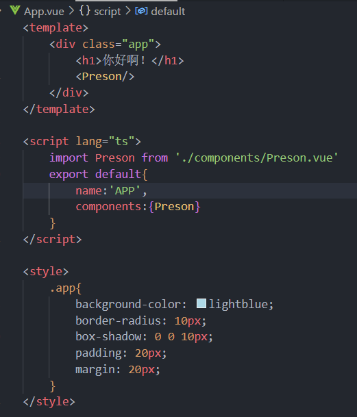
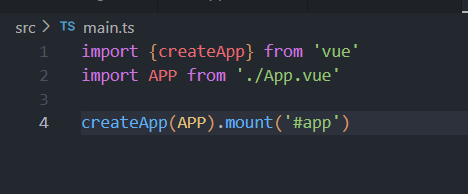
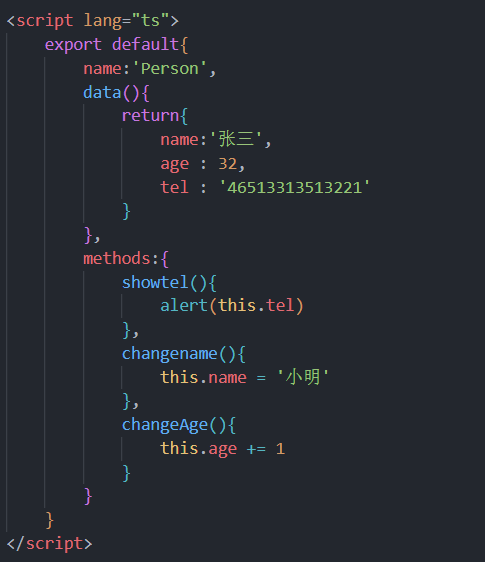
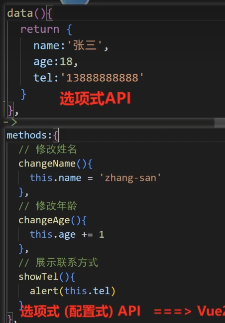

### 创建安装vue

安装node.js环境

[https://nodejs.org/zh-cn/download/package-manager](https://nodejs.org/zh-cn/download/package-manager)

```
npm config set registry https://registry.npmmirror.com //下太慢换源
npm install -g pnpm //装pnpm下载更快
```

安装vue

```
pnpm create vue@latest
```

### 运行前端项目

```
pnpm i   //安装其余依赖
npm run dev  //启动项目
```

## src文件



看ts部分中的export default (指定模块默认导出) 、name 无所谓可随便取、components为组件注册

//import 随机名字 from 路径 和Python中的 （improt 函数 as 别名 ）类似



`import {createApp} from 'vue'`：这行代码从Vue库中导入了`createApp`函数。`createApp`是Vue 3中引入的一个新的全局API，用于创建一个新的Vue应用实例。

导入App.vue

调用createApp()函数初始化APP并通过mount()函数挂载到DOM id=app中





data()、methodes:{}等为optionsAPI

Vue3为setup()

## setup()

```
<script lang="ts">
    export default{
        name:'Preson',
        //vue3 中的setup 把data 和 methodes 合并 但是 数据不是响应式(修改后在外部不会跟随改变)
        //vue3 setup  中无法使用this this在vue3中被淡化
        //vue3 setup   加载优先级非常高
        //data(){}中可以用this方法调用到setup中的数据但是反过来不行
        setup(){
            //data
            let name = '张三'
            let age = 39
            let tel = '233333333'
            //函数
            function changename(){
                name = '小米'
            }
            function changeAge(){
                age += 1
            }
            function showtel(){
                alert(tel)
            }
            return{name,age,tel,changename,changeAge,showtel}
        }
    }
</script>
```
