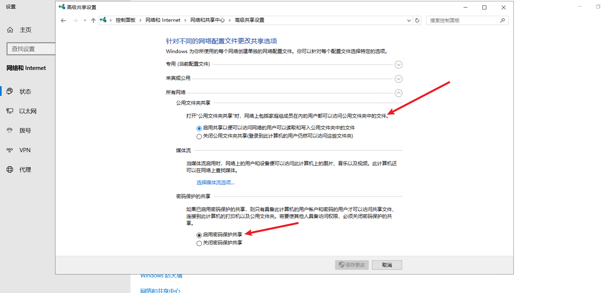
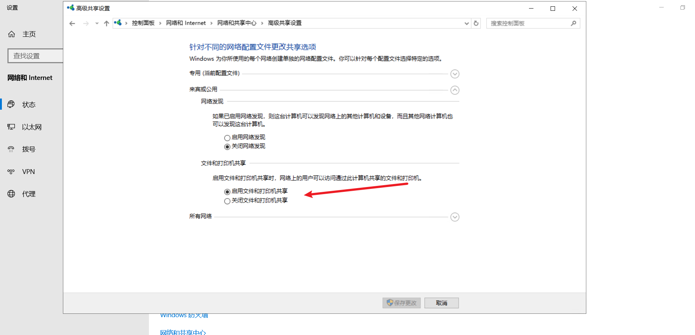
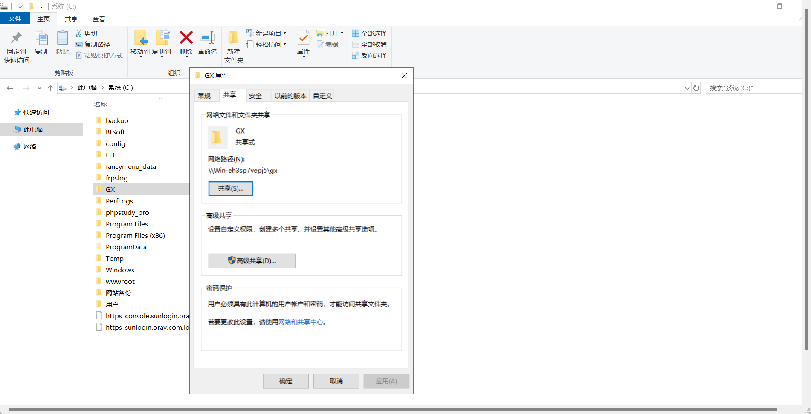
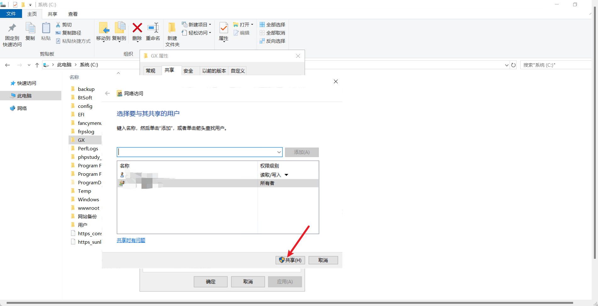
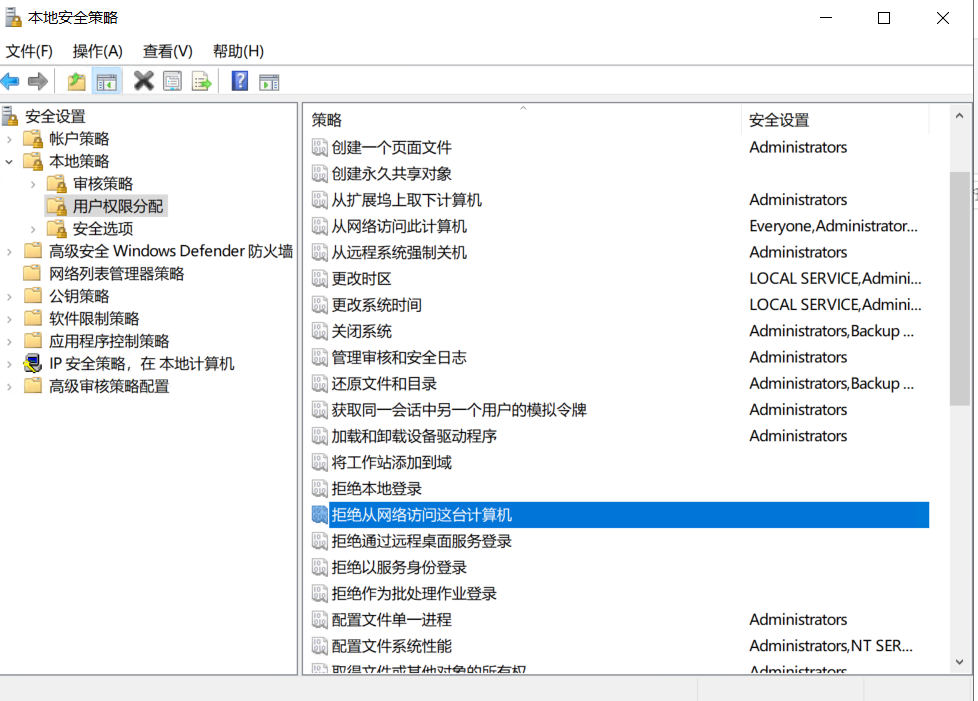
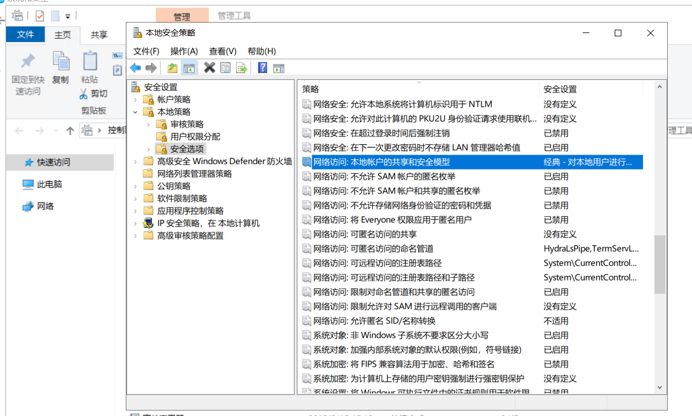
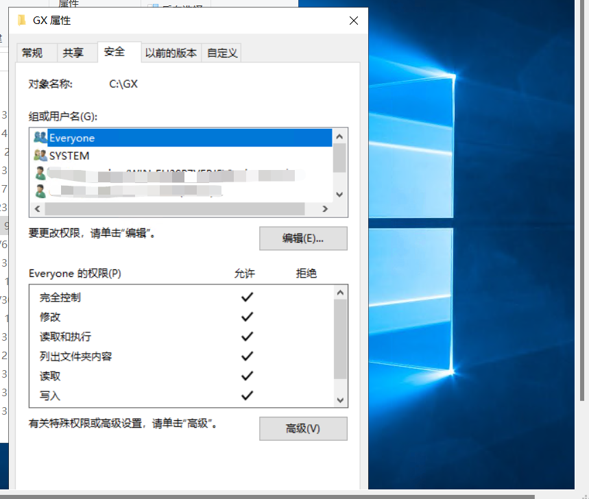
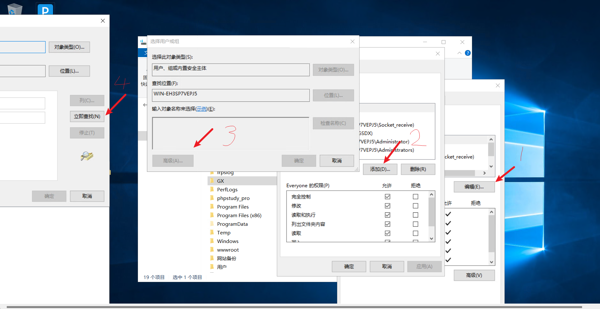
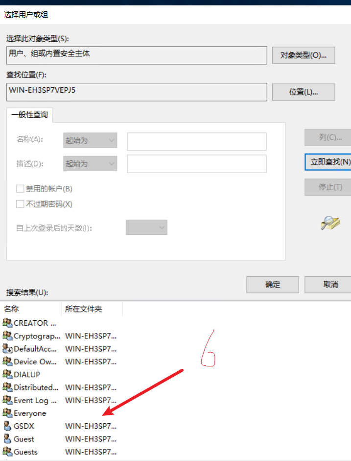
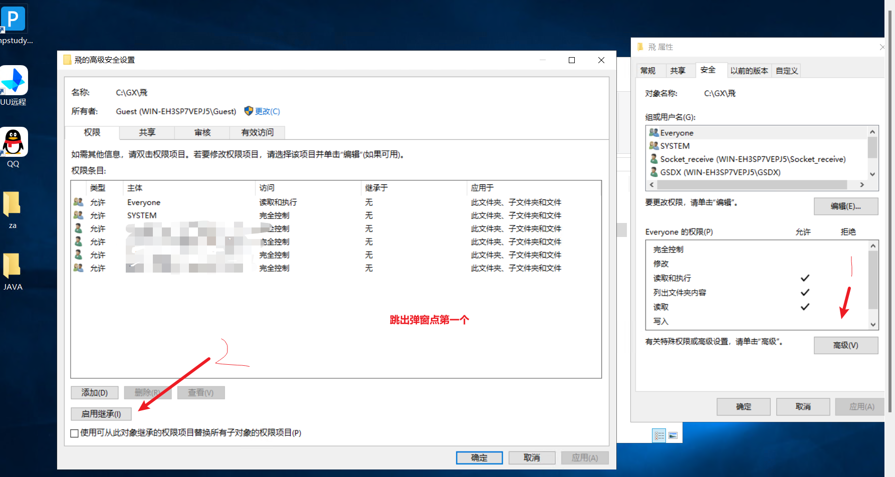

打开网络共享中心的高级共享设置勾选上以下选项





找一个文件夹点击共享





防火墙开放端口

```
New-NetFirewallRule -DisplayName "Allow SMB" -Direction Inbound -Protocol TCP -LocalPort 445 -Action Allow
```

客户端输入

```
\\IP\<共享文件夹名>
```

权限设置

第一步：进入“控制面板-> 系统和安全-> 管理工具 -> 本地安全策略-> 本地策略-> 用户权限分配”，查找 “拒绝从网络访问这台计算机” ，右键-> 属性 -> 删除 Guest 即可【或者双击，然后删除 Guest】。



第二步：在“本地策略->安全选项” 中查找 “网络访问：本地账户的共享和模型”，选择经典。



对公共文件夹设置everyone







**要设置不同用户不同权限**

1.按Windows+R打开"运行"，在空白框中输入`lusrmgr.msc`，然后点击"确定"。打开本地用户和组。在用户创建用户名和密码

把账号放入安全组中设置权限即可

单个文件夹单独权限-取消继承



个性化->主题->桌面图标设置
